# DH-02 — Arquitectura y diseño del Sistema de Mantenimiento y Órdenes de Trabajo

**Evaluación 2 · Software Design II · Digital Horizon Initiative**
**Cliente:** Facilities and Campus Operations — Horizon University
**Equipo:** Hernán Mundell, David Gutierrez, Mike Buelvas
**Contenido:** Evaluación 2, secciones 1 a 7 (diseño). Las secciones 8 a 10 (interfaces, seguridad y despliegue, validación y trazabilidad) quedan fuera del alcance de esta entrega.
**Fecha:** 2026-10-11

> **Pregunta central de la evaluación:** ¿Puede el equipo justificar cómo debe estructurarse el sistema propuesto?

## Cómo leer este documento

Todo el contenido es **diseño propuesto**. Ningún valor numérico de este documento es un resultado medido.

| Etiqueta | Significado |
|---|---|
| **[Cliente]** | Respuesta registrada del stakeholder (Clarification Log, `CL-xxx`). |
| **[RFP]** | Texto del Request for Proposal DH-02. |
| **[Equipo]** | Decisión o propuesta del equipo, aún sin validar con el stakeholder. |
| **[Supuesto]** | Creencia de trabajo registrada en el Assumption Log (`ASM-xxx`). |
| **DISEÑADO / IMPLEMENTADO / VERIFICADO** | Estado de evidencia de un comportamiento. En esta versión todo está en **DISEÑADO**: no hay comportamiento implementado ni verificado. |

Los artefactos de la Evaluación 1 se **enlazan**, no se copian: Product Vision and Scope, Stakeholder Register, Clarification Log, Assumption Log, Success Criteria, Risk Register y Product Backlog.


*Figura F01. Cadena de evidencia que este documento recorre. Las secciones 1 y 2 cubren los requisitos; las secciones 3 y 4, calidad, drivers y decisiones.*

---

# 1. Propósito y alcance acordado

## 1.1 — Problema y resultado esperado

Facilities and Campus Operations recibe los reportes de mantenimiento por correo, llamadas, mensajería, formularios en papel, contacto directo con técnicos y avisos al personal de seguridad, y coordina el trabajo con hojas de cálculo, carpetas de correo y notas personales **[RFP]**. Esto produce reportes duplicados, urgencia evaluada sin criterio común, asignaciones informales, cierres sin confirmar y ausencia de un historial reconstruible.

**Enunciado del problema**

> La universidad carece de un proceso único y controlado mediante el cual un solicitante pueda reportar un problema de mantenimiento, el personal de Facilities pueda validarlo y asignarlo a un responsable explícito, el técnico pueda documentar su ejecución, y el afectado pueda confirmar que el problema quedó resuelto, conservando un historial reconstruible de cada decisión.

**Resultado deseado:** un ciclo de vida comprensible, un responsable explícito en cada orden activa y un historial defendible de asignaciones, bloqueos, transferencias y cierres. No se busca solamente "una pantalla donde se reportan daños".

**Hallazgo de la Evaluación 1 que estructura el diseño:** el problema es la falta de un proceso estructurado, no la tecnología en sí.

## 1.2 — Separar el diseño del producto del alcance de la prueba de concepto

| Capa de alcance | Contenido |
|---|---|
| **Diseño del producto** | Solicitud con ubicación, triage (validar, rechazar, duplicados, urgencia), orden de trabajo con responsable explícito, ejecución con evidencia, bloqueos, transferencia, resolución, cierre (confirmado o automático), reapertura, notificaciones por estado, historial inmutable, tablero operativo básico, integraciones simuladas. |
| **Posible prueba de concepto de la Evaluación 2** *(propuesta, por aprobar por el equipo)* | Un flujo completo: reporte → triage → orden asignada → ejecución con evidencia → bloqueo → resolución → cierre; más una asignación concurrente sobre la misma orden, una acción no autorizada y el cierre automático por vencimiento. |
| **Cobertura de diseño de apoyo** | Transferencia entre técnicos, reapertura, reglas configurables, despliegue y recuperación. |
| **Fuera del alcance del producto** | IoT y sensores, compras y finanzas, pagos a contratistas, nómina y horarios completos, mesa de ayuda de TI, GIS completo, registro empresarial de activos, proyectos de construcción, machine learning, sistemas reales de seguridad o registros reales de mantenimiento **[RFP]**. |

**Decisión de diseño [Equipo]:** una solicitud y su orden se asocian a **una ubicación principal**, coherente con el RFP, que indica que la mayoría de las órdenes involucran una sola ubicación. Las visitas múltiples y la intervención de varios técnicos se representan con bloqueos y transferencias (ver `ASM-012`), sin una entidad "Visita" propia en el diseño inicial.

## 1.3 — Restricciones del RFP que condicionan el diseño

| Restricción **[RFP]** | Consecuencia para el diseño |
|---|---|
| Solo información sintética | Datos de prueba ficticios; ninguna integración con datos reales. |
| Autenticación institucional o simulada equivalente | Servicio de identidad simulado detrás de un contrato (`ASM-001`). |
| Acceso según el rol y la relación con la orden | La autorización depende del rol **y** del recurso (edificio, orden, asignación), no solo del rol. |
| Más de un edificio y dos campus | La ubicación proviene de un directorio, no se gestiona localmente (`CL-008`, `ASM-002`). |
| Asignaciones y cambios de estado trazables | Historial inmutable ligado a cada cambio aceptado. |
| Independencia de otros proyectos | Ninguna dependencia de otros sistemas de estudiantes. |
| Pocos recursos técnicos, solución mantenible | Pocas piezas en ejecución y un entorno reproducible. |
| Acceso remoto | Interfaz web utilizable también desde el móvil por los técnicos. |
| Factible en un semestre | Prueba de concepto pequeña y enfocada en el mayor riesgo. |
| Información de seguridad con trato adecuado | Pregunta abierta (ver 2.4); no se asume una política. |
| Prioridades, categorías y reglas de servicio cambiables | Reglas configurables, no fijadas en el código (`RSK-01`). |
| Sin control de equipos ni sensores reales | Sin integración con infraestructura de edificios. |

## 1.4 — Dimensiones preliminares de operación

Cifras del RFP, **preliminares y sujetas a aclaración** con el stakeholder:

| Dimensión | Valor preliminar |
|---|---|
| Campus / edificios / espacios | 2 / ~25 / más de 300 |
| Técnicos internos | 12–18, más contratistas externos |
| Reportes por mes | ~250–400, con picos al inicio de periodos académicos y tras clima severo |

Estas cifras servirán para definir la carga de las pruebas en la sección 3 (escenarios de calidad). No justifican por sí mismas una arquitectura distribuida.

---

# 2. Requisitos, reglas y supuestos

## 2.1 — Los stakeholders se convierten en preocupaciones y permisos

| Stakeholder | Preocupación principal | Consecuencia de diseño |
|---|---|---|
| **STK-01** Solicitantes | Saber el estado de su reporte; evitar cierres sin reparación real | Estado visible en un panel propio, notificación en cada estado y confirmación de cierre. |
| **STK-02** Coordinador de Facilities | Validar, agrupar duplicados y fijar la urgencia | El triage es un paso previo a la orden; comandos con permisos propios. |
| **STK-03** Técnicos | Asignaciones claras con ubicación, permisos y materiales | Vista de trabajo propia, bloqueos con causal y tolerancia a conectividad limitada (`ASM-004`). |
| **STK-04** Supervisor | Visibilidad de carga y gestión de atrasos | Consultas de carga por técnico, alertas y reasignación. |
| **STK-05** Representantes de edificio | Autorizar accesos y confirmar la finalización | Rol con alcance por edificio y poder de confirmar o rechazar el cierre. |
| **STK-06** Contratistas | Órdenes acotadas y sin ambigüedad de alcance | Asignatario externo con visibilidad limitada a sus órdenes. |
| **STK-07** Servicios de TI | Mantenibilidad, autenticación por roles, integraciones controladas | Servicios externos tras adaptadores simulados; pocas piezas operativas. |
| **STK-08** Director de Operaciones (sponsor) | Trazabilidad, problemas recurrentes, control del alcance | Historial reconstruible, tablero operativo y límites de alcance explícitos. |

## 2.2 — Vocabulario congelado antes de dibujar

| Término | Significado usado en todo el documento |
|---|---|
| **Solicitud de mantenimiento** | Reporte inicial del solicitante. No es trabajo ejecutable. |
| **Triage** | Revisión del coordinador que valida, rechaza, marca duplicados y confirma la urgencia. |
| **Orden de trabajo** | Trabajo ejecutable creado a partir de una solicitud validada, con responsable explícito. |
| **Responsable** | Técnico interno o contratista asignado a una orden activa. |
| **Evidencia** | Foto, nota u observación que demuestra una acción del técnico en el sitio. |
| **Bloqueo** | Detención justificada de la orden, con causal obligatoria (acceso o materiales). |
| **Transferencia** | Cambio de responsable iniciado por el técnico, con motivo (p. ej. mal diagnóstico). |
| **Reasignación** | Cambio de responsable iniciado por el supervisor (p. ej. orden atrasada). |
| **Cierre confirmado** | Cierre tras la aprobación del solicitante o del representante de edificio. |
| **Cierre automático** | Cierre por vencimiento del plazo sin respuesta del afectado (lo que el equipo llama "finalizada"). |
| **Historial de auditoría** | Registro inmutable de cada cambio, con actor y marca de tiempo. |
| **Directorio de ubicaciones simulado** | Fuente externa de edificios, salas y espacios restringidos (`ASM-002`). |
| **Servicio de identidad simulado** | Fuente externa de usuarios y roles (`ASM-001`). |

**Dos distinciones que no deben confundirse:**

- **Solicitud validada ≠ orden asignada.** Una solicitud solo se convierte en orden tras el triage **[Cliente: CL-001]**.
- **Orden resuelta ≠ orden cerrada.** El técnico marca *Resuelta*; el cierre depende del afectado **[Cliente: CL-004]**.

### Estados acordados

| Objeto | Estados |
|---|---|
| **Solicitud** | En Revisión · Validada · Rechazada · Cerrado (Duplicado) |
| **Orden de trabajo** | Asignada · En Progreso · Bloqueada (Esperando Materiales) · Bloqueada (Esperando Acceso) · Resuelta · Cerrada |
| **Atributo de cierre** | Tipo de cierre: *Confirmado* o *Automático* |

La transferencia **no** es un estado: es un evento que mantiene siempre un responsable **[Equipo]**. Estos nombres reemplazan a las variantes de la Evaluación 1 ("En Espera de…" pasa a "Bloqueada (Esperando…)", coherente con `CL-005`). La máquina de estados completa se diseña en la sección 6.

## 2.3 — Supuestos y decisiones no resueltas

Los `ASM-001` a `ASM-005` se mantienen del Assumption Log de la Evaluación 1. Se actualizan o añaden los siguientes.

| ID | Supuesto | Consecuencia si es falso / quién valida | Estado |
|---|---|---|---|
| **ASM-006** *(reformulado)* | Si el afectado no confirma ni rechaza el cierre en **3 días** desde que el técnico marca *Resuelta*, el sistema cierra la orden con tipo **Automático**. Antes, el afectado recibe recordatorios diarios y ve la orden en un apartado de pendientes dentro de la aplicación. | Si el cliente no acepta el cierre sin confirmación, hay que cambiar la regla y el criterio SC-05. Valida el Product Owner con el Coordinador. | Decisión del equipo, sin validar |
| **ASM-007** | La reapertura es posible hasta 48 h después de *Cerrada* (`US-12`). | El plazo cambia la regla de reapertura. Valida el Coordinador. | Propuesto |
| **ASM-008** | La alerta de orden sin atención a las 48 h (`CL-007`) es provisional; las reglas de escalado siguen en revisión. | Cambia el motor de reglas. Valida el Supervisor. | **Abierto** |
| **ASM-009** | Una transferencia no requiere aceptación del técnico receptor; exige motivo y avisa al supervisor. | Si se exige aceptación, aparece un estado intermedio ("Transferencia pendiente"). Valida el Supervisor. | Propuesto |
| **ASM-010** | Qué cambios de estado exigen evidencia es una regla configurable. Matriz inicial en 2.7. | Si el cliente fija otras reglas, solo cambia configuración. Valida el Coordinador y el Supervisor. | Propuesto |
| **ASM-011** | Las notificaciones al solicitante son simuladas (mensajes dentro de la aplicación y un servicio de notificación simulado); no hay correo ni SMS reales. | Si se requiere correo real, se añade un adaptador. Valida TI. | Propuesto |
| **ASM-012** | Una orden concierne a una ubicación principal; las visitas múltiples se representan con bloqueos y transferencias. | Si se requiere programación de visitas, se añade una entidad y un calendario. Valida el Supervisor. | Propuesto |
| **ASM-013** | Las marcas de tiempo se guardan en UTC y se muestran en la zona horaria institucional, aún por confirmar. | Afecta los plazos de 3 días y 48 h. Valida TI. | Propuesto |
| **ASM-014** | El plazo de "3 días" se cuenta en **horas corridas (72 h)**, no en días hábiles. | Si son días hábiles, los fines de semana alteran el reloj de cierre. Valida el Product Owner. | **Abierto** |
| **ASM-015** | En la demostración, las fotos y adjuntos se guardan en el sistema de archivos del servidor y la base de datos conserva solo sus metadatos. | Si TI exige otro almacenamiento, cambia el contenedor de adjuntos. Valida TI. | Propuesto |
| **ASM-016** | Las reglas configurables (ADR-006) se cargan por configuración en la demostración; no hay pantalla de administración de reglas. | Si el cliente exige editarlas desde la aplicación, se añade un módulo de administración y un rol. Valida el Product Owner. | Propuesto |
| **ASM-017** *(reformulado)* | Cada solicitud guarda el código de la ubicación y una copia de sus datos tomada del directorio al reportar (campus, edificio, piso, espacio, tipo, restringida, activa y fecha de obtención), para que el historial siga siendo legible aunque el directorio cambie o desactive el espacio. El directorio simulado entrega el código del edificio, no su nombre (este está en `buildings.csv`). | Si el directorio garantiza identificadores estables y permanentes, la copia puede reducirse al código. Valida TI. | Propuesto |
| **ASM-018** | La base de datos es MySQL **8.0.16 o superior** (ADR-009). | Con una versión anterior, las restricciones `CHECK` se ignoran y no se garantiza BR-04. Valida el equipo al preparar el entorno. | Propuesto |
| **ASM-019** | Los roles de aplicación (coordinador, supervisor, técnico, representante de edificio, contratista) y su alcance (unidad o edificio) se mantienen en un catálogo local `AsignacionRol`, cargado por configuración. El servicio de identidad simulado solo entrega identidad y rol institucional (estudiante, docente, empleado). **Precisa `ASM-001`**, que atribuía los roles al servicio simulado. Los contratistas no tienen datos de ejemplo y quedan fuera de la prueba de concepto. | Si TI entrega roles en la identidad, el catálogo pasa a ser una caché de lectura y el alcance sigue siendo local (el pack no dice qué edificio representa cada persona). Valida TI y el profesor. | Propuesto |
| **ASM-020** | El selector de ubicaciones necesita listar espacios por edificio, pero el contrato del pack solo define `GET /mock/campus-locations/{location_code}`. Se asume que el mock propio del equipo añade un listado por edificio sobre los mismos datos (`locations.json`); si no es aceptable, el selector usa la proyección local cargada desde el archivo. | Si el directorio solo permite consulta por código, RF-01 pasa a entrada de código o a carga inicial desde archivo. Valida el profesor y TI. | Propuesto |
| **ASM-021** | Política ante el directorio al reportar: código inexistente (404) o inactivo (410) → la solicitud se rechaza sin escribir; directorio no disponible (503) o respuesta inválida → la solicitud se acepta con la ubicación *sin verificar* y el coordinador debe verificarla antes de crear la orden, que falla cerrada. Las órdenes existentes no se revalidan: el pack tiene una orden activa (`WO-3008`) sobre un espacio hoy inactivo. | Si el cliente prefiere no aceptar reportes sin ubicación verificada, se pierde disponibilidad de entrada, incluidos los reportes urgentes de Seguridad. Valida el Coordinador y TI. | Propuesto |
| **ASM-022** | Los técnicos y sus habilidades (unidad, disponibilidad, `authorized_for_restricted_locations`) son datos de referencia locales cargados desde `technicians.csv` y `technician_skills.csv`. Asignar un técnico no habilitado a una ubicación restringida genera una **advertencia** que el coordinador reconoce, no un bloqueo: el pack indica que el indicador es simplificado y que puede requerirse supervisión local. `TECH-004` a `TECH-007` no existen en `mock_identities.json`; para iniciar sesión necesitan identidad en la semilla de la demostración. | Si el cliente exige impedir la asignación, la advertencia pasa a ser una regla de rechazo configurable (E2-ADR-006). Valida el Supervisor. | Propuesto |
| **ASM-023** | Un reporte puede registrarlo un tercero (Seguridad por teléfono, `MNT-2003`; el coordinador desde un correo). La solicitud distingue a quien la registra del afectado. La confirmación de cierre se solicita al afectado; si el registrante es un canal institucional (Seguridad) o no hay afectado, se solicita al representante del edificio. Puede responder el afectado o cualquier representante con alcance en el edificio. El pack muestra otra práctica: `CNF-10003` pide la confirmación a `HU-EMP-2202` (el supervisor). | Cambia el destinatario de los recordatorios y la precondición de UC-05. Valida el Coordinador. | **Abierto** |
| **ASM-024** | Los bloqueos tienen causal *acceso* o *materiales* (`CL-005`); el acceso se subdivide en acceso requerido, acceso supervisado y llave no disponible (valores del pack). El pack también contiene un bloqueo por espera de una orden relacionada (`BLK-7004`, sin causal registrada); este diseño no lo adopta como tercera causal ni como estado y lo representa con la relación `orden_padre_id` y una nota. | Si el cliente quiere una causal propia, se añade a la política y un estado de bloqueo. Valida el Supervisor. | **Abierto** |
| **ASM-025** | Los niveles de prioridad del pack (Crítica, Alta, Normal, Baja, con metas de revisión y de asignación de 30/60, 240/240, 2.880/4.320 y 5.760/10.080 minutos) se cargan como política versionada. La alerta general de 48 h (`CL-007`, `ASM-008`) se trata como valor por defecto, no como regla única: la meta de revisión de una orden Crítica (30 min) es muy inferior. | Cambia el motor de alertas y el tablero. Valida el Supervisor. | **Abierto** |
| **ASM-026** | Reabrir una orden cerrada crea una **solicitud nueva vinculada** (`reabre_orden_id`) que pasa por el triage; la orden cerrada no cambia y conserva su evidencia y su cierre. El pack muestra otra práctica: `WO-3006` aparece *Reopened* con la misma identidad. | Si el cliente quiere conservar la identidad, la orden cerrada necesita una transición de retorno y cambia 6.9. Valida el Coordinador. | Propuesto |
| **ASM-027** | Los motivos de rechazo de una solicitud incluyen *fuera de alcance* (redirigida a otra unidad, como `MNT-2012`, un problema de red) e *información incompleta* (como `MNT-2006`, sin espacio). No existe un estado «Requiere información»: el solicitante envía una solicitud nueva. | Si el cliente quiere conversar con el solicitante antes de rechazar, se añade un estado. Valida el Coordinador. | Propuesto |
| **ASM-028** | Regla de recuperación del planificador: si al procesar un cierre automático el retraso respecto al plazo supera 1 hora (por una caída de la aplicación), no se cierra de inmediato: se emiten los recordatorios pendientes y el cierre se reprograma 24 horas después. | Evita cerrar sin oportunidad documentada tras una caída (SC-05). Valida el Product Owner. | Propuesto |

**Estado de todas las filas: propuesto o abierto. Ninguna ha sido validada por el cliente en esta versión.**

### Preguntas del RFP aún sin respuesta registrada

| Tema | Por qué importa para el diseño |
|---|---|
| ¿Quién puede enviar solicitudes (¿solo autenticados?, ¿personal de seguridad por terceros?) | Define roles, el servicio de identidad y la entrada de reportes de otros canales. El pack muestra reportes de Seguridad por teléfono (`MNT-2003`): ver `ASM-023`. |
| ¿Cómo se maneja la información relacionada con seguridad? | Puede exigir clasificación, visibilidad restringida y escalamiento prioritario. |
| ¿Cómo se programan las visitas y las intervenciones de varios técnicos? | Decide si hace falta una entidad de programación. |
| ¿Qué acciones requieren aprobación? | Define tareas de aprobación y permisos. |
| ¿Los contratistas usan el sistema directamente? | Define su rol, alcance y autenticación. |
| ¿Cómo se manejan los picos de demanda? | Determina la carga de referencia de las pruebas. |

## 2.4 — Catálogo de requisitos del diseño

El **Product Backlog** de la Evaluación 1 es la fuente única de historias de usuario. Este catálogo las enlaza con su significado arquitectónico; no las redefine.

| ID | Requisito | Origen | Prioridad | Significado arquitectónico |
|---|---|---|---|---|
| **RF-01** | El solicitante registra una solicitud eligiendo ubicación, categoría y descripción con foto. | US-01 · `CL-008` | Must | Punto único de entrada; adaptador del directorio; almacenamiento de adjuntos. |
| **RF-02** | El solicitante consulta el estado de sus solicitudes y recibe una notificación en cada estado. | US-02 · [Equipo] CH-03 | Must | Modelo de estados visible al usuario; mecanismo de notificación fiable. |
| **RF-03** | El coordinador valida o rechaza (con motivo) y confirma la urgencia sugerida por el solicitante. | US-03 · `CL-003` | Must | Triage como paso previo; permisos de edición de prioridad. |
| **RF-04** | El sistema sugiere posibles duplicados y el coordinador los vincula a una solicitud maestra. | US-04 · `CL-002` · [Equipo] CH-04 | Must | Regla de coincidencia (ubicación + ventana de tiempo; la categoría ordena las sugerencias pero no se exige, porque en el pack del profesor hay duplicados con categorías distintas: `MNT-2001` y `MNT-2002`); vínculo maestro–secundaria. |
| **RF-05** | El coordinador crea la orden desde una solicitud validada y asigna un responsable explícito. | US-05 · `CL-001` | Must | Separación solicitud/orden; invariante "toda orden activa tiene responsable". |
| **RF-06** | El técnico ve sus órdenes asignadas por ubicación y urgencia. | US-06 | Must | Consultas por responsable; vista móvil. |
| **RF-07** | El técnico cambia el estado de la orden; cada cambio puede exigir evidencia según una regla configurable; los bloqueos exigen causal. | US-07 · US-08 · `CL-005` · [Equipo] CH-02 | Must | Máquina de estados explícita; reglas de evidencia configurables. |
| **RF-08** | El técnico transfiere la orden a otro técnico con motivo; el supervisor reasigna o escala órdenes atrasadas. | US-11 · `CL-007` · [Equipo] CH-01 | Should | Cambio de responsable atómico; control de concurrencia. |
| **RF-09** | El afectado confirma o rechaza el cierre (con motivo); recibe recordatorios diarios y ve un apartado de pendientes; al vencer el plazo, el cierre es automático y queda marcado como tal. | US-09 · `CL-004` · `ASM-006` | Must | Plazo y recordatorios programados; tipo de cierre distinguible. |
| **RF-10** | El afectado reabre un caso cerrado dentro del plazo, conservando el vínculo con el caso anterior. | US-12 · `ASM-007` | Should | Transición de retorno; vínculo histórico. |
| **RF-11** | El sistema registra un historial inmutable de cada cambio, asignación, transferencia, cierre y reapertura. | US-10 | Must | Registro de auditoría ligado a cada mutación aceptada. |
| **RF-12** | El gestor consulta un tablero con atrasos, bloqueos, carga por técnico y ubicaciones críticas. | US-13 | Should | Consultas acotadas con definiciones de negocio consistentes. |
| **RF-13** | El usuario se autentica con identidad simulada y accede según su rol y su relación con la orden. | `ASM-001` · [Equipo] (sin historia en el backlog) | Must | Identidad confiable más autorización por recurso. |

### Cambios respecto a la Evaluación 1, con justificación

| ID | Cambio | Origen | Justificación | Estado |
|---|---|---|---|---|
| CH-01 | Transferencia entre técnicos por mal diagnóstico u otro motivo | Equipo | Cubre el caso en que el técnico detecta que la falla es de otra especialidad. | Pendiente de validar con el Supervisor |
| CH-02 | Evidencia configurable por cambio de estado | Equipo | Los técnicos deben demostrar que fueron al sitio; no todo cambio lo exige. | Pendiente de validar |
| CH-03 | Notificación al solicitante en cada estado | Equipo | Atiende el dolor principal de STK-01. | Pendiente de validar |
| CH-04 | Duplicados con detección asistida más vinculación del coordinador | Equipo, alineado con `CL-002` | Un punto único de entrada con ubicación estructurada facilita sugerir candidatos sin fusionar automáticamente. | Propuesto |
| CH-05 | SC-01 sin la cifra del 80 % | Falta de línea base | Evita una meta sin fuente. | Aplicado |
| CH-06 | Cierre automático a los 3 días con recordatorios diarios | Equipo | Evita órdenes atrapadas en *Resuelta*, pero obliga a reformular SC-05 (ver abajo). | Pendiente de validar con el Product Owner |
| CH-07 | Backlog como fuente única; nueva historia de autenticación y roles; historias para notificaciones, transferencia y evidencia | Equipo | Elimina conteos contradictorios y la referencia a una historia inexistente (US-18). | Propuesto |
| CH-08 | Adelantar el historial de auditoría al Sprint 1 | Equipo | Si captura cada cambio de estado, llegar tarde obliga a reescribir. | Propuesto |

**Reformulación de SC-05 derivada de CH-06**

> *Antes:* "Ninguna orden se cierra definitivamente sin la confirmación del solicitante o representante de edificio."
> *Propuesta:* "Ninguna orden se cierra sin que el afectado haya tenido una oportunidad documentada de confirmar o rechazar (recordatorios diarios durante 3 días). Todo cierre automático queda marcado como tal en el historial y puede reabrirse dentro del plazo de reapertura."

## 2.5 — Reglas de negocio e invariantes

| ID | Regla / invariante | Origen |
|---|---|---|
| **BR-01** | Una solicitud no es una orden ejecutable; solo tras el triage se crea una orden. | [Cliente] CL-001 |
| **BR-02** | El solicitante sugiere la urgencia; solo el coordinador o el supervisor la validan o modifican. | [Cliente] CL-003 |
| **BR-03** | Solo el coordinador vincula duplicados; la solicitud secundaria pasa a *Cerrado (Duplicado)* con el ID de la maestra y el solicitante es notificado. | [Cliente] CL-002 |
| **BR-04** | Toda orden activa tiene **exactamente un responsable** (técnico o contratista). Ninguna operación deja una orden activa sin responsable, incluida la transferencia. | SC-03 · [Equipo] |
| **BR-05** | El técnico no cierra una orden: la marca *Resuelta*. | [Cliente] CL-004 |
| **BR-06** | Una orden *Resuelta* se cierra por confirmación del solicitante o del representante de edificio, o automáticamente al vencer el plazo tras los recordatorios. El tipo de cierre siempre queda registrado. | CL-004 · ASM-006 |
| **BR-07** | Rechazar el cierre exige un motivo y devuelve la orden a *En Progreso*. | US-09 |
| **BR-08** | Un bloqueo exige causal (acceso o materiales) y notifica al supervisor. | CL-005 · SC-04 |
| **BR-09** | Cada cambio de estado se acepta solo si cumple la regla de evidencia vigente para esa transición. | [Equipo] CH-02 |
| **BR-10** | Todo cambio de estado, asignación, transferencia, reasignación, cierre y reapertura genera un registro de auditoría inmutable con actor y marca de tiempo. | SC-06 · US-10 |
| **BR-11** | El solicitante es notificado en cada cambio de estado de su solicitud. | [Equipo] CH-03 |
| **BR-12** | La autorización se verifica en el servidor para cada operación protegida, según el rol y la relación con la orden. | [RFP] |
| **BR-13** | Los materiales y repuestos se registran como justificación; el sistema no ejecuta compras ni transacciones contables. | CL-006 · ASM-005 |
| **BR-14** | Las reglas de prioridad, escalamiento y evidencia son configurables sin modificar el código. | RSK-01 · [RFP] |

### Matriz inicial de evidencia por transición *(propuesta, ASM-010)*

| Transición | ¿Evidencia? |
|---|---|
| Asignada → En Progreso (llegada al sitio) | Sí |
| En Progreso → Bloqueada | Sí (causal más prueba del impedimento) |
| Bloqueada → En Progreso | Opcional |
| Transferencia a otro técnico | Motivo obligatorio; evidencia opcional |
| En Progreso → Resuelta | Sí (observaciones y foto) |
| Resuelta → Cerrada | No (la decide el afectado) |

## 2.6 — Escenario sintético usado en todo el documento

Todos los diagramas y casos usarán estos mismos identificadores ficticios.

| Elemento | Valor |
|---|---|
| Solicitud principal | `MR-104` — fuga de agua en un lavamanos de laboratorio |
| Solicitante | `HU-FAC-2101` (Paula Mendez, docente), identidad del servicio simulado |
| Solicitud duplicada | `MR-105`, mismo espacio, reportada por `HU-STU-2001` (Samuel Rios, estudiante) |
| Ubicación | `MAIN-B03-LAB201`, Laboratory 201 del edificio `MAIN-B03` (Science and Laboratories); **restringida: sí** y activa (directorio simulado) |
| Urgencia | Sugerida *Normal* por el solicitante; confirmada *Alta* por el coordinador `HU-EMP-2201` |
| Orden de trabajo | `WO-104`, asignada inicialmente a `TECH-004` (Luisa Andrade, mantenimiento general; **no** habilitada para ubicaciones restringidas) |
| Bloqueo | Falta de autorización de acceso al laboratorio; `HU-EMP-2203` (Ana Sofia Ramirez, responsable del laboratorio) la otorga después |
| Transferencia | `TECH-004` detecta que la falla es de plomería especializada y transfiere a `TECH-002` (Mariana Ibarra, especialista en plomería, habilitada) con motivo "mal diagnóstico". Una reasignación concurrente del supervisor `HU-EMP-2202` ilustra QS-01 |
| Resolución | `TECH-002` marca *Resuelta* con observaciones y foto |
| Cierre | Variante A: `HU-FAC-2101` confirma. Variante B: sin respuesta tras 3 días, cierre automático |

Los identificadores de personas, ubicaciones y técnicos provienen del pack del profesor; `MR-104`, `MR-105` y `WO-104` son registros sintéticos nuevos. El pack identifica a `HU-EMP-2201`, `HU-EMP-2202` y `HU-EMP-2203` solo como *empleados*: sus roles de aplicación (coordinador, supervisor y responsable del laboratorio) se asignan en el catálogo local de la demostración (`ASM-019`) y se infieren de su aparición en `assigned_by` y `responsible_party`, por lo que deben confirmarse. `TECH-004` no existe en `mock_identities.json` (`ASM-022`). El pack no tiene un nivel de urgencia *Media*: los niveles son Crítica, Alta, Normal y Baja.

## 2.7 — Semántica del tiempo

| Plazo | Regla propuesta | Estado |
|---|---|---|
| Cierre automático | **72 horas corridas** desde el instante en que la orden pasa a *Resuelta*. | Supuesto (`ASM-014` abierto: ¿corridas o hábiles?) |
| Recordatorios al afectado | Uno por día mientras la orden esté *Resuelta* sin respuesta, más un apartado de pendientes visible en la aplicación. | Decisión del equipo |
| Reinicio del reloj | Si el afectado rechaza el cierre y el técnico vuelve a marcar *Resuelta*, el plazo comienza de nuevo. | Propuesto |
| Reapertura | Hasta 48 horas después de *Cerrada*. | Supuesto (`ASM-007`) |
| Alerta por falta de atención | 48 horas sin atención generan una alerta visual para el supervisor. | **Abierto** (`CL-007`) |

Las marcas de tiempo se almacenan en UTC y se muestran en la zona horaria institucional (`ASM-013`). Los plazos se calculan con el reloj del servidor, nunca con el del navegador.

## 2.8 — Flujo de extremo a extremo y la decisión autoritativa

El proceso modela **lo que hace la organización**, no las pantallas.

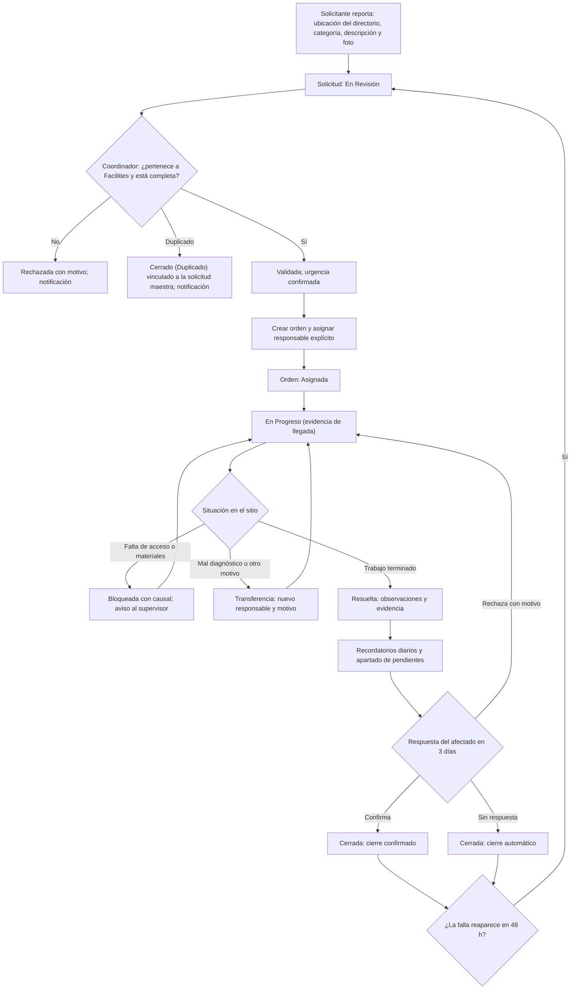

*Figura F02. Proceso TO-BE propuesto. Cada cambio de estado notifica al solicitante y deja un registro de auditoría (BR-10, BR-11). El cierre lo decide el afectado o el vencimiento del plazo, nunca el técnico.*

## 2.9 — Caso de uso detallado: cerrar una orden resuelta

**UC-05 · Cerrar una orden en estado *Resuelta***

| Campo | Valor |
|---|---|
| **Actor principal** | Solicitante o representante de edificio de la orden. Actor secundario: el sistema, para el cierre automático. |
| **Disparador** | El afectado selecciona *Confirmar cierre* o *Rechazar cierre*; o vence el plazo de 72 h. |
| **Precondiciones** | Sesión válida; la orden está *Resuelta*; el actor es el solicitante o el representante del edificio de la orden. |
| **Flujo principal (confirmación)** | Verificar sesión y alcance → verificar que la orden sigue *Resuelta* → cambiar a *Cerrada* con tipo *Confirmado* → registrar el historial → notificar al solicitante y al supervisor. |
| **Flujo alternativo (rechazo)** | Exigir motivo → devolver la orden a *En Progreso* con el mismo responsable → registrar el historial → notificar al técnico y al supervisor. |
| **Flujo alternativo (automático)** | Al cumplirse las 72 h sin respuesta y tras los recordatorios diarios, el sistema cierra la orden con tipo *Automático*, lo registra y notifica al afectado, con opción de reapertura. |
| **Garantía de éxito** | Un único estado final; el historial de auditoría y la notificación quedan registrados junto con el cambio. |
| **Garantía de fallo** | Sin cierre parcial, sin registro de cierre sin cambio de estado y sin notificación de un cierre que no ocurrió. |
| **Alternativas de error** | Actor no autorizado; la orden ya no está *Resuelta* (cierre automático concurrente con una confirmación); motivo ausente al rechazar; fallo temporal de almacenamiento. |
| **Postcondición visible** | El afectado ve la orden cerrada indicando si fue confirmada o automática, y la opción de reapertura mientras dure el plazo. |

**Situación de carrera a diseñar:** el afectado confirma en el mismo instante en que vence el plazo. El resultado debe ser una sola transición de cierre y un solo registro, sin doble cierre. Esta situación se retoma en la sección 3 (escenario de calidad de consistencia) y en la sección 7.

---

# 3. Escenarios de calidad y drivers de arquitectura

Una calidad no se nombra: se **completa** con fuente, estímulo, entorno, artefacto, respuesta y medida. **Todos los valores son metas propuestas, no resultados medidos.**

## 3.1 — Plantilla completada: QS-01

**QS-01 · Integridad de la responsabilidad ante cambios simultáneos**

| Campo | Valor |
|---|---|
| **Fuente** | Dos usuarios autorizados (p. ej. un coordinador y un supervisor). |
| **Estímulo** | Ambos cambian el responsable de la misma orden activa al mismo tiempo, cada uno sobre la versión que vio. |
| **Entorno** | Base de datos y aplicación sanas; orden activa; sesiones independientes. |
| **Artefacto** | Caso de uso de asignación, transferencia y reasignación; almacén autoritativo de órdenes. |
| **Respuesta** | Se confirma un solo cambio; el otro recibe un conflicto de versión y debe refrescar la orden; el historial queda coherente. |
| **Medida** | En cada prueba controlada de dos solicitudes simultáneas, exactamente una tiene éxito; cero órdenes activas con dos responsables o sin responsable; un registro de auditoría por cambio aceptado. |

La expectativa de "exactamente una" depende del entorno sano y de entradas válidas. Con la base de datos caída, ninguna de las dos operaciones puede tener éxito.

## 3.2 — Escenarios críticos y su evidencia

| ID | Calidad / estímulo | Respuesta esperada | Medida propuesta | Evidencia objetivo |
|---|---|---|---|---|
| **QS-02** | **Consistencia en la carrera de cierre.** El afectado confirma el cierre en el mismo instante en que vence el plazo de 72 h. | Una sola transición a *Cerrada*; el tipo de cierre corresponde a la operación que ganó; la otra recibe "ya cerrada". | Exactamente un cierre y un registro de auditoría por orden en cada ensayo; cero cierres dobles. | Dos ejecuciones concurrentes contra la base real; inspección del historial. |
| **QS-03** | **Auditabilidad.** Un supervisor investiga una orden con asignaciones, bloqueos, transferencia y cierre. | Se reconstruye la historia completa y no es posible alterar un registro. | Cada mutación aceptada tiene actor, instante UTC, acción, estado previo y nuevo, responsable previo y nuevo si aplica, motivo y correlación; todo intento de modificar o borrar un registro falla. | Aserciones sobre el historial; intento de edición directa desde la aplicación. |
| **QS-04** | **Seguridad.** Un usuario intenta una acción que no le corresponde (técnico que cierra una orden, solicitante que consulta la de otro, representante de otro edificio que confirma, contratista que ve una orden ajena). | Se deniega en el servidor. | Todos los casos negativos denegados; cero escrituras de negocio protegidas. | Matriz de pruebas por rol, alcance y relación con la orden. |
| **QS-05** | **Modificabilidad de reglas.** Cambia una regla (matriz de evidencia, umbral de alerta de 48 h a 24 h, categorías, ventana de cierre). | La nueva versión se aplica a las transiciones nuevas sin cambiar código ni esquema. | Cambio realizado solo por configuración; pruebas de regresión con la versión anterior y la nueva. | Diferencia de configuración y pruebas de regresión. |
| **QS-06** | **Conectividad limitada.** Un técnico pierde señal en un sótano al registrar un bloqueo con foto y reenvía varias veces. | El borrador se conserva en el dispositivo y el servidor aplica el comando una sola vez. | Tras 3 reenvíos del mismo comando, un solo cambio de estado y un solo registro de auditoría. | Repetición del mismo comando con identificador de operación. |
| **QS-07** | **Fiabilidad de notificaciones y plazos.** Se cambia un estado mientras el servicio de notificación simulado está caído 2 minutos y la aplicación se reinicia. | El estado queda confirmado; las notificaciones, recordatorios y el cierre automático programados no se pierden. | Cero cambios de estado perdidos; notificación entregada en un máximo de 60 s tras restablecerse el servicio *(valor propuesto)*; sin duplicados visibles para el usuario. | Inyección de fallos, reinicio y revisión de la cola de entrega. |

*Alcance de QS-06:* **no** se diseña operación sin conexión completa (`ASM-004`). Si el cliente la exige, la arquitectura del cliente cambia y se registra como riesgo.

## 3.3 — Calidades de apoyo con definición operativa

| ID | Escenario | Meta u observación propuesta |
|---|---|---|
| **QS-08** | Búsqueda y tablero con la carga declarada: ~5.000 órdenes sintéticas (≈12 meses a 400 reportes/mes, **[RFP]**) y 20 usuarios concurrentes. | p95 de respuesta del servidor inferior a 800 ms *(valor de partida tomado del ejemplo de la guía)*. |
| **QS-09** | Un solicitante interpreta estados y cierres. | En un estudio planificado con 5 personas, al menos 4 distinguen *Resuelta* de *Cerrada* y reconocen un cierre automático. |
| **QS-10** | El servicio simulado de directorio devuelve datos inválidos o inexistentes, o se sustituye el adaptador por otro. | El adaptador rechaza el dato y no se escribe estado inválido; las pruebas de contrato del dominio siguen pasando y no hay dependencias prohibidas hacia el adaptador. |

Una demostración con un solo servidor **no** prueba alta disponibilidad, capacidad de producción ni correctitud de integraciones reales.

## 3.4 — Drivers de arquitectura

| Driver | Evidencia | Implicación para la estructura |
|---|---|---|
| **AD-01** Integridad de estados y responsabilidad | BR-04, BR-06; RF-05, RF-08, RF-09; QS-01, QS-02 | Un único almacén autoritativo; transiciones atómicas con control de versión. |
| **AD-02** Reglas cambiantes | BR-14; RF-03, RF-07; QS-05; `RSK-01` | Reglas como datos versionados, separadas de la lógica de transiciones. |
| **AD-03** Decisiones reconstruibles | BR-10; RF-11; QS-03; SC-06 | Historial inmutable escrito junto con cada cambio aceptado. |
| **AD-04** Notificaciones y plazos fiables | BR-06, BR-11; RF-02, RF-09; QS-07 | Plazos y notificaciones persistidos; entrega desacoplada de la petición. |
| **AD-05** Acceso por rol y relación con la orden | BR-12; RF-13; QS-04 | Identidad confiable más autorización en el servidor por recurso. |
| **AD-06** Operación factible para un equipo de 3 | Restricciones del RFP; semestre; STK-07 | Pocas piezas operativas, un solo despliegue, entorno reproducible. |
| **AD-07** Conectividad limitada de técnicos | `ASM-004`; `RSK-03`; QS-06 | Comandos idempotentes y borrador local con reenvío. |
| **AD-08** Integraciones simuladas reemplazables | `ASM-001`, `ASM-002`; SC-07; QS-10 | Servicios externos detrás de adaptadores con contrato. |

Un driver es selectivo: explica una consecuencia de diseño, no copia un ítem del backlog.

## 3.5 — Tensiones antes de elegir tecnologías

| Tensión | Resolución propuesta | Costo aceptado |
|---|---|---|
| Notificación inmediata vs. cambio de estado fiable | Confirmar el cambio y entregar la notificación después, de forma durable | La notificación puede demorar unos segundos. |
| Cierre automático vs. evitar cierres falsos | Cerrar a las 72 h tras recordatorios, marcar el cierre y permitir reapertura | Algunos casos se cerrarán sin respuesta real del afectado. |
| Reglas flexibles vs. simplicidad | Vocabulario pequeño y validado de reglas, no scripts arbitrarios | Un flujo muy distinto requiere un nuevo diseño. |
| Trabajo de campo sin señal vs. complejidad | Borrador local con reenvío, no operación sin conexión completa | Sin señal no se puede cargar información nueva. |
| Historial completo vs. exposición mínima de datos | Guardar los cambios de negocio y restringir su acceso por rol | Algunos detalles de depuración solo viven en el log operativo. |
| Diseño rico vs. factibilidad de un semestre y 3 personas | Probar el corte crítico y documentar el resto como trabajo pendiente | No todas las funciones se implementan en la Evaluación 2. |

Un compromiso es creíble cuando nombra qué empeora, no solo qué mejora.

---

# 4. Estrategia de arquitectura y registros de decisión

## 4.1 — Alternativas comparadas con los drivers reales

Valoración **cualitativa del equipo**: ✔ cumple bien · ~ cumple con costo · ✘ cumple mal.

| Alternativa | AD-01 Integridad | AD-03 Historial | AD-04 Plazos y notificaciones | AD-06 Equipo de 3 | AD-08 Integraciones | Conclusión |
|---|---|---|---|---|---|---|
| **A. Monolito modular** con base de datos relacional única | ✔ Transacciones locales | ✔ Historial en la misma transacción | ✔ Cola y planificador internos | ✔ Un despliegue y una base de código | ✔ Adaptadores | **Seleccionada** |
| **B. Monolito en capas sin fronteras de módulo** | ✔ | ✔ | ✔ | ✔ Muy simple al inicio | ~ Acoplamiento creciente | Descartada: dificulta cambiar reglas e integraciones |
| **C. Microservicios** | ✘ Consistencia entre servicios | ~ Historial distribuido | ~ Mensajería entre servicios | ✘ Mucha operación para 3 personas | ✔ | Descartada: costo desproporcionado para 250–400 reportes al mes |
| **D. Plataforma sin servidor o BaaS** | ~ Depende del proveedor | ~ | ~ | ~ Dependencia y curva nueva | ~ | Descartada: menor control de transacciones y auditoría |

## 4.2 — La estrategia seleccionada en una imagen

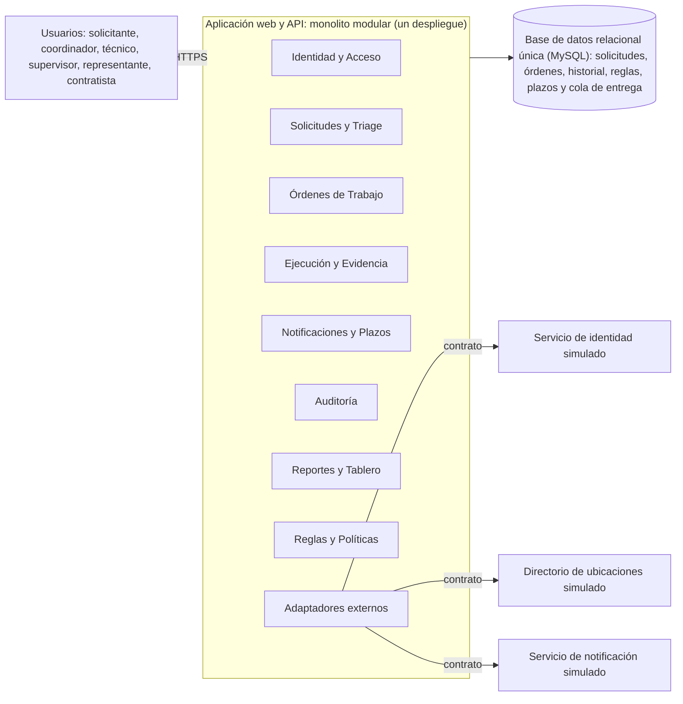

*Figura F03. Una sola unidad desplegable con módulos de fronteras explícitas, una base de datos autoritativa y servicios externos simulados detrás de adaptadores. Un planificador interno procesa plazos y entregas pendientes leyendo el estado persistido (E2-ADR-005).*

## 4.3 — Registro de decisiones

| ID | Decisión | Estado | Driver principal |
|---|---|---|---|
| E2-ADR-001 | Monolito modular con una base de datos relacional | **Seleccionada** (propuesta por el equipo) | AD-06, AD-01 |
| E2-ADR-002 | Máquina de estados centralizada | Propuesta | AD-01, AD-02 |
| E2-ADR-003 | Control de concurrencia optimista por versión | Propuesta | AD-01 |
| E2-ADR-004 | Historial inmutable en la misma transacción | Propuesta | AD-03 |
| E2-ADR-005 | Plazos y notificaciones persistidos con planificador interno | Propuesta | AD-04 |
| E2-ADR-006 | Reglas configurables con vocabulario pequeño y versionado | Propuesta | AD-02 |
| E2-ADR-007 | Autenticación delegada; autorización propia por rol y alcance | Propuesta | AD-05 |
| E2-ADR-008 | Adaptadores para servicios externos simulados | Propuesta | AD-08 |
| E2-ADR-009 | Pila tecnológica: React y Node.js (JavaScript) con MySQL | **Seleccionada** (decisión del equipo) | AD-06 |
| E2-ADR-010 | Adopción parcial del código base del profesor: datos y contratos sí, código Python no | Propuesta | AD-06, AD-08 |

## 4.4 — E2-ADR-001 — Monolito modular con una base de datos relacional

**Estado:** seleccionada · **Fecha:** 2026-10-11 · **Responsable:** equipo

**Contexto.** El equipo es de 3 personas y el proyecto debe ser factible en un semestre. El RFP pide una solución mantenible con pocos recursos técnicos. La carga declarada (~250–400 reportes al mes, 12–18 técnicos) es baja. Las reglas críticas (responsable único, cierre en dos fases, historial) exigen cambios de estado consistentes.

**Decisión.** Una sola aplicación desplegable organizada en módulos con fronteras explícitas (Identidad y Acceso, Solicitudes y Triage, Órdenes de Trabajo, Ejecución y Evidencia, Notificaciones y Plazos, Auditoría, Reportes y Tablero, Reglas y Políticas, Adaptadores externos) sobre una base de datos relacional única. Los módulos se comunican por interfaces explícitas y la organización del código refleja esas fronteras.

**Alternativas.** Monolito en capas sin módulos (acopla reglas e integraciones); microservicios (consistencia distribuida y operación excesiva para 3 personas); plataforma sin servidor o BaaS (menos control sobre transacciones y auditoría).

**Consecuencias.**
- *Positivas:* un despliegue y un entorno local sencillos; transacciones que cubren el cambio de estado, el historial y la cola de notificaciones; cada integrante puede responsabilizarse de módulos.
- *Costos:* las fronteras dependen de disciplina del equipo; no se escala por módulo; un fallo del servidor interrumpe todo el servicio. Se acepta: no se declara alta disponibilidad.

**Verificación.** Revisión de dependencias entre módulos (QS-10); pruebas de transacciones y concurrencia (QS-01, QS-02).

**Reconsideración.** Si la carga crece en órdenes de magnitud, si varios equipos trabajan en paralelo o si un módulo requiere escalar por separado.

**Trazas.** AD-06, AD-01 → restricciones del RFP, STK-07 → vista de contenedores (F03) → pruebas de transacción y concurrencia.

## 4.5 — E2-ADR-002 a E2-ADR-008 (resumen)

**E2-ADR-002 · Máquina de estados centralizada**
- *Contexto:* BR-05 a BR-09 imponen quién puede cambiar qué estado, con qué evidencia y con qué efectos.
- *Decisión:* toda transición de solicitud y de orden pasa por un único componente con una tabla de transiciones (origen, actor, condiciones, efectos: historial, notificación, plazo).
- *Alternativas:* condicionales dispersos por el código; un motor externo de flujos de trabajo.
- *Consecuencias:* + comportamiento consistente y comprobable; − la tabla requiere mantenimiento y cambios de flujo implican cambiar código.
- *Verificación:* prueba de cada transición válida y de transiciones prohibidas.
- *Reconsideración:* si los flujos se vuelven demasiado variables.

**E2-ADR-003 · Control de concurrencia optimista por versión**
- *Contexto:* QS-01, QS-02 y `RSK-02`.
- *Decisión:* cada comando sobre una orden lleva la versión vista; se aplica dentro de la transacción solo si coincide; si no, se responde con un conflicto de versión. La base de datos refuerza que toda orden activa tenga un responsable.
- *Alternativas:* última escritura gana; bloqueo pesimista de la orden; confiar en que la interfaz evite el choque.
- *Consecuencias:* + sin bloqueos largos y con conflictos detectados; − el usuario puede recibir un conflicto y debe refrescar.
- *Verificación:* pruebas con dos sesiones independientes sobre la base real.
- *Reconsideración:* si los conflictos son frecuentes en la práctica.

**E2-ADR-004 · Historial inmutable en la misma transacción**
- *Contexto:* BR-10; SC-06; QS-03.
- *Decisión:* el registro de auditoría se escribe junto con cada cambio aceptado, en solo anexado; la aplicación no expone actualización ni borrado.
- *Alternativas:* registros de aplicación; historial asíncrono; historia de eventos como fuente de verdad.
- *Consecuencias:* + el historial no puede divergir del estado; − escritura algo más pesada y mayor volumen de datos. No se adopta eventos como fuente de verdad por su complejidad.
- *Verificación:* aserciones del historial; intento de alteración directa.
- *Reconsideración:* si se requieren proyecciones históricas complejas.

**E2-ADR-005 · Plazos y notificaciones persistidos con planificador interno**
- *Contexto:* BR-06, BR-11; QS-07; el cierre automático y los recordatorios diarios deben sobrevivir a reinicios.
- *Decisión:* en la misma transacción del cambio se guardan las notificaciones pendientes y los plazos (recordatorios, cierre automático). Un planificador interno procesa los elementos vencidos y entrega mediante el adaptador, con un identificador por entrega para evitar duplicados.
- *Alternativas:* enviar en la propia petición; un broker externo; temporizadores en memoria.
- *Consecuencias:* + nada se pierde ante reinicios o caídas del servicio de notificación; − retraso de unos segundos y necesidad de mostrar el estado de entrega. La entrega es al menos una vez, con deduplicación.
- *Verificación:* inyección de fallos y reinicio.
- *Reconsideración:* si el volumen exige un broker.

**E2-ADR-006 · Reglas configurables con vocabulario pequeño y versionado**
- *Contexto:* BR-14; `RSK-01`; QS-05.
- *Decisión:* matriz de evidencia, categorías, niveles de prioridad, umbrales de alerta y ventana de cierre viven como datos versionados. Cada evaluación registra la versión usada.
- *Alternativas:* reglas fijas en el código; scripts o lenguaje propio; un motor de reglas externo.
- *Consecuencias:* + cambios sin reescribir código; − expresividad limitada.
- *Verificación:* regresión con versión anterior y nueva.
- *Reconsideración:* si aparecen reglas que el vocabulario no puede expresar.

**E2-ADR-007 · Autenticación delegada; autorización propia por rol y alcance**
- *Contexto:* BR-12; `ASM-001`; QS-04.
- *Decisión:* la identidad y los roles provienen del servicio simulado; la aplicación decide en el servidor, para cada comando, según rol y relación con la orden (solicitante propio, técnico asignado, representante del edificio, contratista asignado).
- *Alternativas:* verificar solo el rol; ocultar opciones en la interfaz; autorización en la base de datos por fila.
- *Consecuencias:* + protección real y comprobable; − más casos de prueba negativos.
- *Verificación:* matriz de QS-04.
- *Reconsideración:* si cambia el modelo de roles institucional.

**E2-ADR-008 · Adaptadores para servicios externos simulados**
- *Contexto:* `CL-008`; `ASM-001`, `ASM-002`; SC-07; QS-10.
- *Decisión:* identidad, directorio de ubicaciones y notificación se consumen a través de puertos con contrato; los simulados son una implementación sustituible.
- *Alternativas:* llamar a los simulados desde el dominio; copiar el catálogo de ubicaciones localmente.
- *Consecuencias:* + el dominio no depende de un proveedor; − capa adicional y pruebas de contrato.
- *Verificación:* pruebas de contrato y revisión de dependencias.
- *Reconsideración:* si TI entrega un servicio real con otro contrato.

**E2-ADR-009 · Pila tecnológica**

*Estado:* seleccionada · *Fecha:* 2026-10-11 · *Responsable:* equipo

- **Contexto.** El monolito modular (ADR-001) exige transacciones relacionales con restricciones, pruebas de concurrencia con sesiones independientes (QS-01, QS-02) y un entorno local reproducible para un equipo de 3 personas (AD-06). El RFP deja la tecnología a criterio del equipo.
- **Decisión (equipo).** Interfaz en **React con JavaScript**; backend en **Node.js con JavaScript**; base de datos relacional **MySQL** (motor InnoDB). Un solo lenguaje en todo el sistema.
- **Alternativas consideradas.** Backend en Python (dos lenguajes en el proyecto); TypeScript en lugar de JavaScript (tipos compartidos, pero el equipo optó por JavaScript); PostgreSQL (propuesta inicial, sustituida por la decisión del equipo a favor de MySQL).
- **Supuesto de versión (`ASM-018`).** MySQL **8.0.16 o superior**: desde esa versión las restricciones `CHECK` se aplican y desde 8.0 existe el bloqueo de filas que omite las ya bloqueadas, útil para el planificador.

**Implicaciones de MySQL en decisiones anteriores**

| Decisión | Mecanismo en MySQL | Cuidado a tener |
|---|---|---|
| ADR-003 control de versión | Actualización condicionada por identificador y versión; se comprueban las filas afectadas dentro de la transacción | Incrementar siempre la versión para que la actualización cambie la fila; probar con dos conexiones independientes, sin depender del nivel de aislamiento por defecto. |
| BR-04 un responsable por orden activa | Columna de responsable obligatoria en todos los estados (la orden cerrada conserva el último) más un índice único sobre la asignación vigente; el `CHECK` se usa para el tipo de responsable y el tipo de cierre (6.7) | Verificar la versión del servidor (`ASM-018`); una versión anterior ignora las restricciones sin avisar. |
| ADR-004 historial inmutable | El usuario de base de datos de la aplicación no recibe permisos de actualizar ni borrar sobre la tabla de auditoría | Evitar que migraciones o scripts usen un usuario con más permisos. |
| ADR-005 planificador y entregas | Tabla de entregas y plazos; lectura de pendientes con bloqueo que omite filas ya tomadas | Solo necesario si hay más de una instancia; con una sola instancia basta con el estado de entrega. |
| Migraciones | Scripts pequeños y reversibles | Las sentencias que modifican el esquema confirman la transacción de forma implícita en MySQL: una migración fallida puede quedar a medias. |

**Consecuencias del uso de JavaScript sin tipos.** No hay verificación de tipos en compilación ni tipos compartidos entre interfaz y servidor. Se compensa con validación de esquemas en la frontera de la API, contratos de la API (no desarrollados en esta entrega) y pruebas de contrato. Es un costo asumido: los errores de forma de datos aparecen en ejecución o en pruebas, no al compilar.

**Verificación.** Prueba de concurrencia sobre MySQL real con dos conexiones independientes (QS-01, QS-02); comprobación automática de la versión del servidor y de que una restricción `CHECK` rechaza un dato inválido.

**Reconsideración.** Si TI impone otra base de datos, si la versión de MySQL disponible es anterior a 8.0.16, o si los errores de datos por falta de tipos se vuelven frecuentes.

**E2-ADR-010 · Adopción parcial del código base del profesor**

*Estado:* propuesta · *Fecha:* 2026-10-11 · *Responsable:* equipo (sigue la plantilla `ADR-000` del starter)

- **Contexto.** El profesor entregó un starter (Python 3.12, FastAPI, SQLAlchemy, SQLite con PostgreSQL opcional, importadores CSV y JSON, servicios simulados de identidad y de información estudiantil, y una tabla genérica `imported_records`) y el pack DH-02 (CSV crudos y de referencia, directorio simulado de ubicaciones y escenarios). El propio starter declara que no decide el modelo, la arquitectura ni la tecnología, y que el equipo puede sustituir lenguaje, framework y base de datos si lo documenta.
- **Decisión (equipo).**

| Acción | Componente |
|---|---|
| **Retener** | La estructura `data/{raw, reference, events, scenarios, generated}`; los archivos crudos sin modificar (las transformaciones van a `data/generated/`); el contrato del directorio `GET /mock/campus-locations/{location_code}` con sus respuestas 404, 410 y 503; el contrato de identidad `GET /mock/identity/users/{user_id}` y la cabecera `X-Mock-User-Id`, solo en el perfil de desarrollo. |
| **Modificar** | La identidad de la demostración: se parte de `mock_identities.json` y la semilla añade `TECH-004` a `TECH-007` (los roles no se añaden al mock, `ASM-019`). El validador y el cargador de semilla se reescriben en Node.js. |
| **Reemplazar** | Backend Python, FastAPI y SQLAlchemy por Node.js (E2-ADR-009); la tabla genérica `imported_records` por el esquema de la sección 6; SQLite y PostgreSQL por MySQL. |
| **Retirar** | El servicio simulado de información estudiantil, los ejemplos `sample_*` y el `docker-compose` de PostgreSQL (se sustituye por uno de MySQL). |

- **Alternativas consideradas.** Adoptar el starter completo en Python; backend Python con interfaz React (dos lenguajes en el proyecto); seguir con Node.js ignorando los contratos del pack (se pierde la compatibilidad con lo que el profesor espera ver).
- **Justificación.** E2-ADR-009 elige un solo lenguaje y MySQL (AD-06). El valor del starter para DH-02 está en los datos y los contratos, no en su código genérico. Hay fricción concreta: el starter lee `data/reference/mock_users.json` con usuarios `HU-STU-1001`…, mientras el pack entrega `mock_identities.json` con otros usuarios y otros identificadores; cargar el pack en el starter no alimenta su identidad simulada sin renombrar archivos.
- **Consecuencias.** *Positivas:* coherencia técnica y datos crudos intactos. *Costos:* reescribir validador y cargador en Node.js (`scripts/validar-datos` y `scripts/cargar-semilla`), perder las pruebas del starter y el riesgo de divergir de los contratos, que se compensa con pruebas de contrato (QS-10). La decisión necesita la aceptación del profesor.
- **Verificación.** Informe de validación de la semilla que liste las irregularidades conocidas del pack (6.6) sin modificar los archivos crudos; pruebas de contrato del adaptador de directorio con 200, 404, 410 y 503.
- **Reconsideración.** Si el profesor exige el starter o su lenguaje.

---

## 4.6 — Patrones y principios que resuelven un problema nombrado

| Patrón o principio | Problema que resuelve | Dónde se aplica |
|---|---|---|
| Tabla de transiciones (estado) | Condiciones de estado dispersas y transiciones inválidas | ADR-002 |
| Versionado optimista | Cambios simultáneos sobre la misma orden | ADR-003 |
| Repositorio | Lógica de negocio acoplada al acceso a datos | Módulos de dominio |
| Adaptador / puerto | Dependencia del dominio con servicios externos | ADR-008 |
| Política por versión (estrategia) | Reglas cambiantes sin reescribir el evaluador | ADR-006 |
| Bandeja de salida (outbox) | Notificaciones y plazos perdidos ante fallos | ADR-005 |

No se adoptan eventos de dominio distribuidos ni microservicios: no hay un problema nombrado que los justifique en este alcance.

---

# 5. Vistas estructurales y responsabilidades

## 5.1 — Cada vista responde la pregunta de su audiencia

| Audiencia | Pregunta | Vista |
|---|---|---|
| Sponsor y usuarios | ¿Quién usa el sistema y con qué servicios se relaciona? | **V-CTX** Contexto |
| Arquitecto y equipo de desarrollo | ¿Qué partes ejecutables colaboran y quién es dueño de qué datos? | **V-CONT** Contenedores |
| Equipo de backend | ¿Cómo se reparten las responsabilidades dentro del servidor? | **V-COMP** Componentes |
| Equipo de desarrollo | ¿Cómo se organiza el código para respetar esas fronteras? | **V-DEV** Organización del código |

Una vista es útil porque omite a propósito lo que no le importa a su audiencia. El despliegue no se desarrolla en esta entrega (ver «Alcance de esta entrega»).

## 5.2 — V-CTX · Contexto del sistema

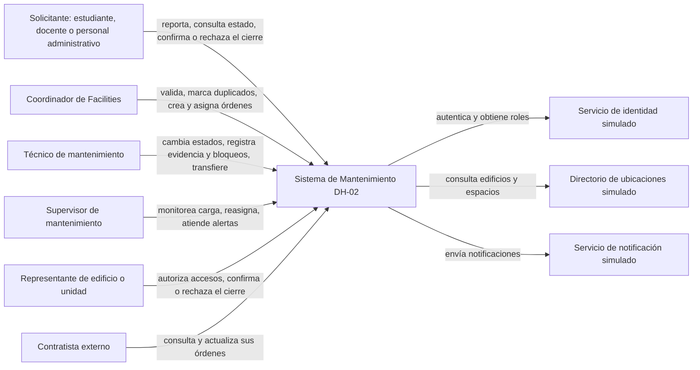

*Figura F04. Muestra personas y sistemas; omite la tecnología interna.*

### Catálogo de relaciones del contexto

| Relación | Qué fluye | Observación |
|---|---|---|
| Usuarios → Sistema | Comandos y consultas, siempre autenticados | Los permisos dependen del rol y de la relación con la orden (BR-12). |
| Sistema → Servicio de identidad | Identidad y rol del usuario | Contrato simulado (`ASM-001`). |
| Sistema → Directorio de ubicaciones | Edificios, salas y espacios restringidos | El sistema no administra ubicaciones (`CL-008`, `ASM-002`). |
| Sistema → Servicio de notificación | Mensajes al solicitante y alertas al supervisor | Entrega durable y desacoplada (ADR-005); sin correo ni SMS reales (`ASM-011`). |

## 5.3 — V-CONT · Contenedores y conexiones

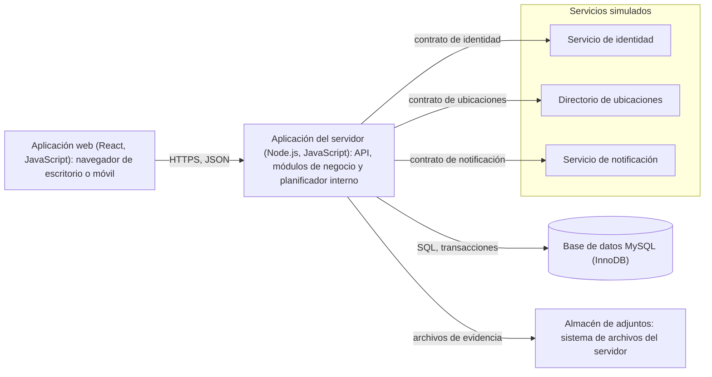

*Figura F05. Cuatro piezas propias y tres servicios simulados. El monolito modular es una sola unidad desplegable (E2-ADR-001).*

## 5.4 — Cada contenedor declara también lo que no hace

| Contenedor | Responsabilidades | No es responsable de |
|---|---|---|
| **Aplicación web (React)** | Presentar formularios, paneles y apartado de pendientes; enviar comandos con la versión vista; conservar el borrador local de la acción del técnico y reenviarla (QS-06). | Decidir permisos, validar reglas de negocio ni calcular plazos: lo hace el servidor. |
| **Aplicación del servidor (Node.js)** | Autenticar la sesión, autorizar cada comando, aplicar transiciones, escribir historial, procesar plazos y entregas pendientes, exponer consultas. | Administrar usuarios, ubicaciones o el envío real de mensajes: son servicios externos simulados. |
| **Base de datos MySQL** | Persistir el estado autoritativo, el historial, las reglas, los plazos y la cola de entrega; sostener transacciones y restricciones. | Contener lógica de negocio compleja ni orquestar flujos. |
| **Almacén de adjuntos** | Guardar archivos de evidencia (`ASM-015`). | Ser fuente de verdad del estado; la base de datos guarda los metadatos. |
| **Servicios simulados** | Imitar identidad, directorio y notificación detrás de un contrato. | Representar el comportamiento real de los servicios de producción. |

## 5.5 — La propiedad de los datos es un contrato de diseño

| Dato | Dueño | Modifica | Observación |
|---|---|---|---|
| Identidad: sujeto, nombre, correo, rol institucional, activo | **Servicio de identidad** (externo) | Nadie en el sistema | El sistema guarda solo el identificador del sujeto; nombre y correo se consultan al mostrar y no se copian al historial (5.12). |
| Roles de aplicación y alcance (coordinador, supervisor, técnico, representante, contratista) | **Identidad y Acceso** (catálogo local `AsignacionRol`) | Carga por configuración (`ASM-016`, `ASM-019`) | El pack del profesor no entrega roles ni quién representa cada edificio. Ningún rol enviado por el navegador se acepta. |
| Perfil técnico: unidad, disponibilidad, habilidades, habilitación para ubicaciones restringidas | **Órdenes de Trabajo** (datos de referencia locales) | Carga por configuración desde la semilla | Es un indicador simplificado: genera advertencia, no bloqueo (`ASM-022`). |
| Ubicaciones | **Directorio** (externo) | Nadie en el sistema | Copia local acotada: `ProyeccionUbicacion` (caché con fecha de obtención, propiedad de Adaptadores externos) y los datos copiados en la solicitud al reportar (`ASM-017`, `ASM-021`). |
| Solicitudes, adjuntos de la solicitud y vínculo de duplicado | **Solicitudes y Triage** | Solicitante (crea) y coordinador (valida, rechaza, vincula) | Una solicitud secundaria referencia a su maestra. |
| Órdenes, responsable, transferencias, reasignaciones, estado y tipo de cierre | **Órdenes de Trabajo** | Coordinador, técnico, supervisor y afectado, solo a través de comandos autorizados; el sistema para el cierre automático | Única fuente del estado de la orden. |
| Observaciones, materiales, evidencias y causales de bloqueo | **Ejecución y Evidencia** | Técnico | **No cambia el estado**: solicita la transición al módulo Órdenes de Trabajo. |
| Historial de auditoría | **Auditoría** | Solo se anexa, como parte de cada cambio aceptado | Sin actualización ni borrado desde la aplicación (ADR-004). |
| Reglas y políticas versionadas | **Reglas y Políticas** | Carga por configuración (`ASM-016`) | Cada evaluación registra la versión usada. |
| Notificaciones, recordatorios y plazos | **Notificaciones y Plazos** | Se crean con el cambio de estado; el planificador actualiza su estado de entrega | Estados de entrega: pendiente, entregada, fallida. |
| Reportes y tablero | **Reportes y Tablero** | Ninguno | Consultas de solo lectura con definiciones de negocio únicas. |

## 5.6 — V-COMP · Componentes dentro de la aplicación del servidor

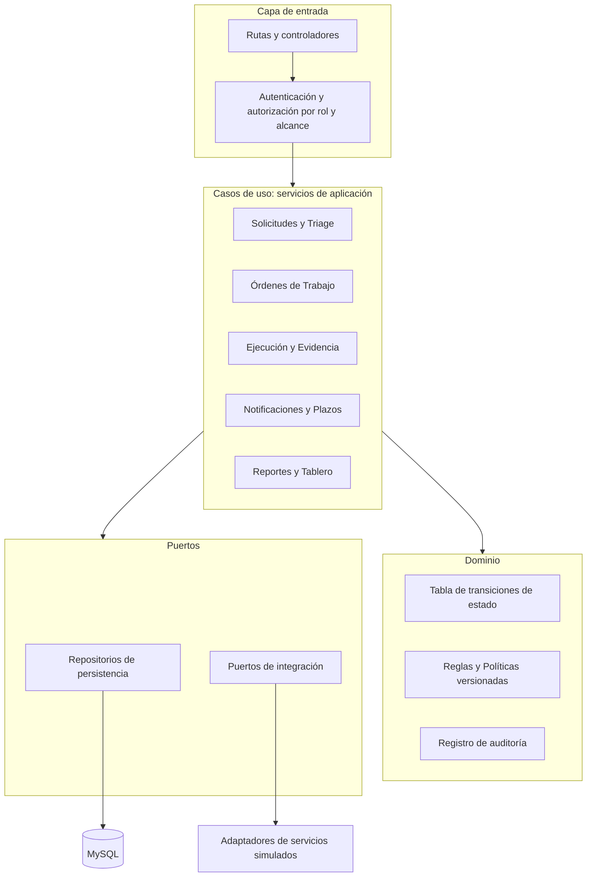

*Figura F06. Las flechas indican dependencia. El dominio no conoce la base de datos ni los servicios externos.*

## 5.7 — Especificación de un componente: servicio de órdenes de trabajo

| Campo | Valor |
|---|---|
| **Propósito** | Ser la única puerta para cambiar el estado, el responsable o el cierre de una orden. |
| **Comandos que acepta** | Crear orden, asignar, transferir, reasignar, cambiar estado, bloquear, resolver, confirmar cierre, rechazar cierre, cerrar por vencimiento, corregir categoría, cambiar prioridad, reabrir (crea una solicitud vinculada, `ASM-026`). |
| **Entradas de cada comando** | Identificador de la orden, **versión esperada**, actor, datos propios del comando y un identificador de operación para reintentos idempotentes. |
| **Resultado** | Orden actualizada con su nueva versión, o un error de negocio con la acción de recuperación. |
| **Colabora con** | Autorización (alcance), tabla de transiciones (guardas), política de evidencia vigente, repositorio de órdenes, repositorio de auditoría y bandeja de notificaciones. |
| **Invariantes que protege** | BR-04, BR-05, BR-06, BR-07, BR-08, BR-09, BR-10. |
| **Errores definidos** | No autorizado · Transición inválida · Versión obsoleta · Evidencia requerida · Motivo requerido · Orden no encontrada · Operación repetida (devuelve el resultado anterior). |
| **Qué no hace** | No envía notificaciones por sí mismo, no consulta ubicaciones y no usa el reloj del navegador para los plazos. |

**Garantía:** el cambio de estado, el registro de auditoría y la notificación pendiente se confirman juntos o ninguno se confirma.

## 5.8 — Foco de diseño: dirección de las dependencias en el cierre de una orden

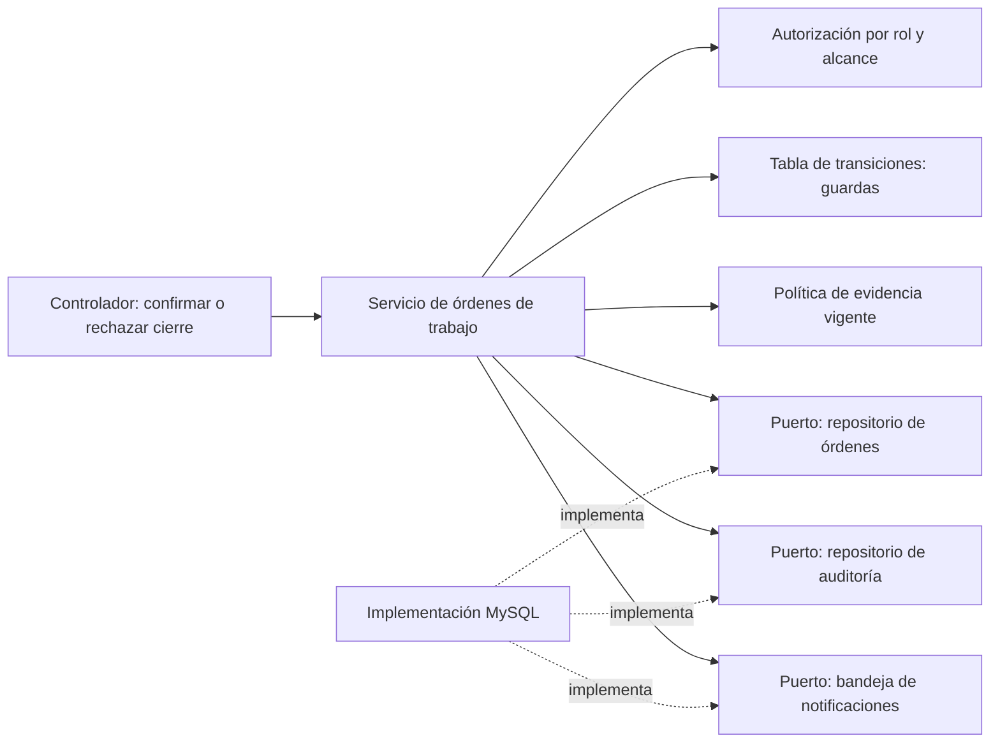

*Figura F07. El caso de uso depende de interfaces; MySQL implementa esas interfaces. Así la regla de cierre se prueba sin base de datos y el mecanismo de persistencia se cambia sin tocar el dominio.*

## 5.9 — El planificador interno tiene responsabilidades propias

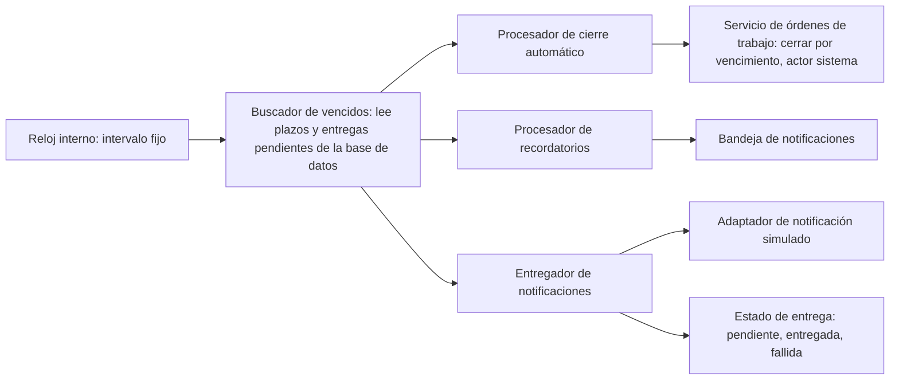

*Figura F08. El planificador no decide cerrar una orden por su cuenta: pide el cierre al mismo servicio y bajo la misma comprobación de versión que una confirmación humana. Eso evita el doble cierre de QS-02. Todo su estado vive en la base de datos, por lo que un reinicio no pierde plazos.*

## 5.10 — La organización del código refuerza las mismas fronteras

```text
dh02/
├── frontend/                      # React, JavaScript
│   └── src/
│       ├── paginas/               # solicitante, coordinador, técnico, supervisor
│       ├── componentes/
│       └── api/                   # cliente de la API y reenvío idempotente
└── backend/                       # Node.js, JavaScript
    └── src/
        ├── modulos/
        │   ├── identidad-acceso/
        │   ├── solicitudes-triage/
        │   ├── ordenes-trabajo/
        │   ├── ejecucion-evidencia/
        │   ├── notificaciones-plazos/
        │   ├── auditoria/
        │   ├── reportes-tablero/
        │   └── reglas-politicas/
        ├── adaptadores/           # identidad, ubicaciones, notificación (simulados)
        ├── planificador/          # reloj, procesadores de plazos y entregas
        └── compartido/            # errores, validación de esquemas, configuración
```

Cada módulo expone una interfaz pública y no se importan archivos internos de otro módulo. Esa regla se revisa en las revisiones de código y se comprueba con una herramienta de verificación de dependencias (QS-10). Sin esa comprobación, las fronteras del monolito modular dependen solo de disciplina.

## 5.11 — Registro de consistencia entre vistas

| Concepto | Contexto (F04) | Contenedores (F05) | Componentes (F06) | Código (5.10) |
|---|---|---|---|---|
| El sistema | Sistema de Mantenimiento DH-02 | Aplicación del servidor (Node.js) | Servicios de aplicación y dominio | `backend/src/modulos` |
| Interfaz de usuario | Usuarios | Aplicación web (React) | Capa de entrada (rutas) | `frontend/src` |
| Persistencia | — | Base de datos MySQL | Repositorios → MySQL | repositorios de cada módulo |
| Servicios externos | Identidad, ubicaciones y notificación simulados | Servicios simulados | Puertos de integración → adaptadores | `backend/src/adaptadores` |
| Plazos y entregas | — | Parte de la aplicación del servidor | Notificaciones y Plazos | `backend/src/planificador` |
| Historial | — | Datos en MySQL | Registro de auditoría | `modulos/auditoria` |
| Roles y alcance | Usuarios | Base de datos MySQL | Autenticación y autorización (F06) | `modulos/identidad-acceso` |
| Ubicaciones locales | Directorio de ubicaciones simulado | Base de datos MySQL | Puertos de integración → adaptadores | `backend/src/adaptadores` |

Los nombres de los módulos coinciden con ADR-001, la tabla de propiedad de datos (5.5) y las figuras F03 a F08.

## 5.12 — Personas y ubicaciones: qué entrega el pack del profesor y qué decide el equipo

La propiedad de los datos de 5.5 se contrastó con los archivos del pack DH-02 (`mock_identities.json`, `technicians.csv`, `technician_skills.csv`, `buildings.csv`, `locations.json`, `service-contract.md`, `failure-responses.json` y los CSV crudos). Esa lectura cambió tres afirmaciones de versiones anteriores de este documento: los **roles de aplicación no vienen del servicio de identidad** (`ASM-019`), el **directorio no tiene operación de listado** (`ASM-020`) y una **ubicación inactiva no impide trabajar** sobre órdenes que ya existen (`ASM-021`).

| # | Lo que muestra el pack | Efecto en el diseño | Decisión |
|---|---|---|---|
| 1 | `mock_identities.json` solo trae `user_id`, nombre, correo, `institutional_role` (estudiante, docente o empleado) y `active`. No hay coordinador, supervisor, técnico, representante ni contratista. | `ASM-001` atribuía los roles al servicio simulado; el pack no los entrega. | Roles y alcance en un catálogo local (`ASM-019`). |
| 2 | Ninguna fuente dice qué edificio representa cada persona (`buildings.csv` no tiene responsable). | El alcance por edificio de BR-12 no tiene origen. | El catálogo local incluye el alcance (`ASM-019`). |
| 3 | Solo `TECH-001` a `TECH-003` existen en la identidad; `TECH-004` a `TECH-007` aparecen en `technicians.csv` y en órdenes. `TECH-007` está inactivo pero sigue como responsable de `WO-3006`. | Un técnico sin identidad no puede iniciar sesión; un responsable inactivo deja una asignación obsoleta. | La semilla de la demostración añade esas identidades (E2-ADR-010); los responsables inactivos se listan para reasignación (RF-08, RF-12). |
| 4 | `authorized_for_restricted_locations` es, según el diccionario, un «indicador simplificado» y «la supervisión local puede seguir siendo necesaria». Hay órdenes en ubicaciones restringidas asignadas a un técnico no habilitado (`WO-3005`, `WO-3007`). | Un bloqueo duro contradice la práctica del cliente. | Advertencia que el coordinador reconoce, no bloqueo (`ASM-022`). |
| 5 | El contrato del directorio define solo `GET /mock/campus-locations/{location_code}`. `locations.json` trae el código del edificio, no su nombre (este está en `buildings.csv`). | RF-01 necesita un selector por edificio y espacio. | Listado como extensión del mock propio (`ASM-020`). |
| 6 | Respuestas de fallo del directorio: 404 inexistente, 410 inactiva, 503 no disponible. `WO-3008` está activa sobre `MAIN-B99-STORE`, hoy inactiva. | El historial no puede depender de que el directorio conserve el espacio. | Copia de datos al reportar y política por código de respuesta (`ASM-017`, `ASM-021`). |
| 7 | Los reportes crudos traen campus, edificio y espacio como texto libre con alias («Block 2», «Eng. Building», «Old Annex»); `MNT-2006` no trae espacio. | La selección estructurada evita los alias en reportes nuevos; los datos importados los conservan. | Los importados mantienen su texto original y no se inventa una ubicación; sin código verificado no hay orden. |
| 8 | `MNT-2003` lo registra `SEC-ONCALL` por teléfono; `CNF-10003` pide la confirmación a `HU-EMP-2202`, no al registrante. | Quien registra no siempre es el afectado ni quien confirma. Responde en parte la pregunta abierta sobre personal de seguridad (2.3). | Registrante y afectado separados; confirmador por regla (`ASM-023`). |
| 9 | `ASN-5004`: el técnico determinó que hacía falta un especialista, pero la reasignación la registró `HU-EMP-2202`. | En la práctica actual la transferencia la ejecuta la coordinación o la supervisión, no el técnico. | `ASM-009` y CH-01 siguen pendientes de validar; el diseño admite ambos caminos. |

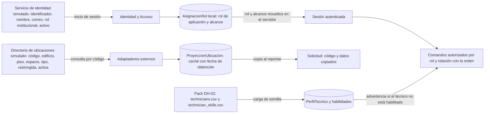

*Figura F09. Origen y propiedad de los datos de personas y ubicaciones. El sistema guarda identificadores de sujeto, no nombres ni correos; los nombres se resuelven al mostrar (6.12).*

**Preguntas para cerrar con el profesor o el cliente.** Hasta recibir respuesta, el diseño sigue la decisión provisional.

| Pregunta | A quién | Decisión provisional |
|---|---|---|
| ¿Los roles de aplicación y los técnicos `TECH-004` a `TECH-007` pueden añadirse al servicio de identidad simulado, o los roles son responsabilidad del sistema? | Profesor / TI | Locales (`ASM-019`). |
| ¿El directorio simulado ofrecerá listado por edificio y nombre del edificio, o solo consulta por código? | Profesor / TI | Extensión del mock propio (`ASM-020`). |
| ¿Quién confirma el cierre cuando reporta Seguridad u otro tercero? | Cliente | Representante del edificio (`ASM-023`). |
| ¿Una orden reabierta conserva su identidad (como `WO-3006`) o nace una solicitud vinculada? | Cliente | Solicitud vinculada (`ASM-026`). |
| ¿«Bloqueada por orden relacionada» (`BLK-7004`) es una causal válida? | Cliente | No adoptada (`ASM-024`). |
| ¿Es aceptable usar Node.js y MySQL en lugar del starter en Python, documentando la decisión? | Profesor | E2-ADR-010. |

---

# 6. Dominio, datos, estados y transacciones

Todo el contenido de esta sección está en estado **DISEÑADO**. Los nombres de tablas y columnas son lógicos: no constituyen un script de migración. Las personas y ubicaciones usan los identificadores del escenario de 2.6, tomados del pack del profesor.

## 6.1 — V-DOM — Conceptos del dominio y cardinalidades

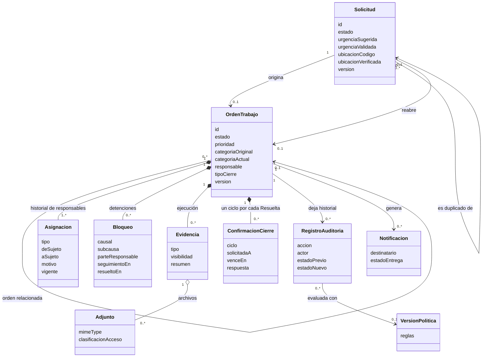

*Figura F10. Modelo conceptual. Personas y ubicaciones aparecen como referencias (identificador de sujeto, código de ubicación), no como entidades propias: su autoridad es externa (5.5).*

- **Dos raíces.** `Solicitud` y `OrdenTrabajo` se modifican por separado. Solo `OrdenTrabajo` cambia de responsable, de estado o de tipo de cierre.
- **Ejecución.** Observaciones, materiales y bloqueos cuelgan de la orden, pero registrarlos no cambia su estado: pide la transición al módulo Órdenes de Trabajo (5.5).
- **Duplicados.** Una solicitud secundaria se conserva como evidencia de impacto (escenario `DH02-SC-02` del pack). El conteo de secundarias por solicitud maestra alimenta el tablero (RF-12).

## 6.2 — La solicitud, la orden y la confirmación son hechos distintos

| Momento | Solicitud | Orden | Confirmación de cierre | Lo que ve el solicitante |
|---|---|---|---|---|
| Reporte recibido | En Revisión | — | — | «Recibida, en revisión». |
| Tras el triage | Validada, urgencia Alta | — | — | «Validada, aún sin responsable». |
| Orden creada | Validada | Asignada a `TECH-004` | — | «Asignada». |
| Bloqueo por acceso | Validada | Bloqueada (Esperando Acceso) | — | «Detenida por falta de acceso». |
| Técnico marca Resuelta | Validada | Resuelta | Ciclo 1 pendiente, vence en 72 h | «Resuelta, pendiente de su confirmación» en el apartado de pendientes. |
| El afectado rechaza | Validada | En Progreso, mismo responsable | Ciclo 1 rechazada con motivo | «El trabajo se reanudó». |
| Nueva resolución | Validada | Resuelta | Ciclo 2 pendiente, 72 h nuevas | Igual que arriba. |
| Sin respuesta en 72 h | Validada | Cerrada (Automático) | Ciclo 2 vencida | «Cerrada automáticamente; puede reabrirla hasta …». |
| Reapertura | Nueva solicitud En Revisión, vinculada | Cerrada, sin cambios | — | «Nuevo caso vinculado al anterior». |

Una solicitud no cambia de estado después de *Validada*: lo que el usuario ve se compone de la solicitud, la orden y la confirmación (6.10). *Resuelta* no es *Cerrada* (CL-004) y una orden cerrada nunca se modifica.

## 6.3 — V-DATA — Modelo relacional lógico del flujo central

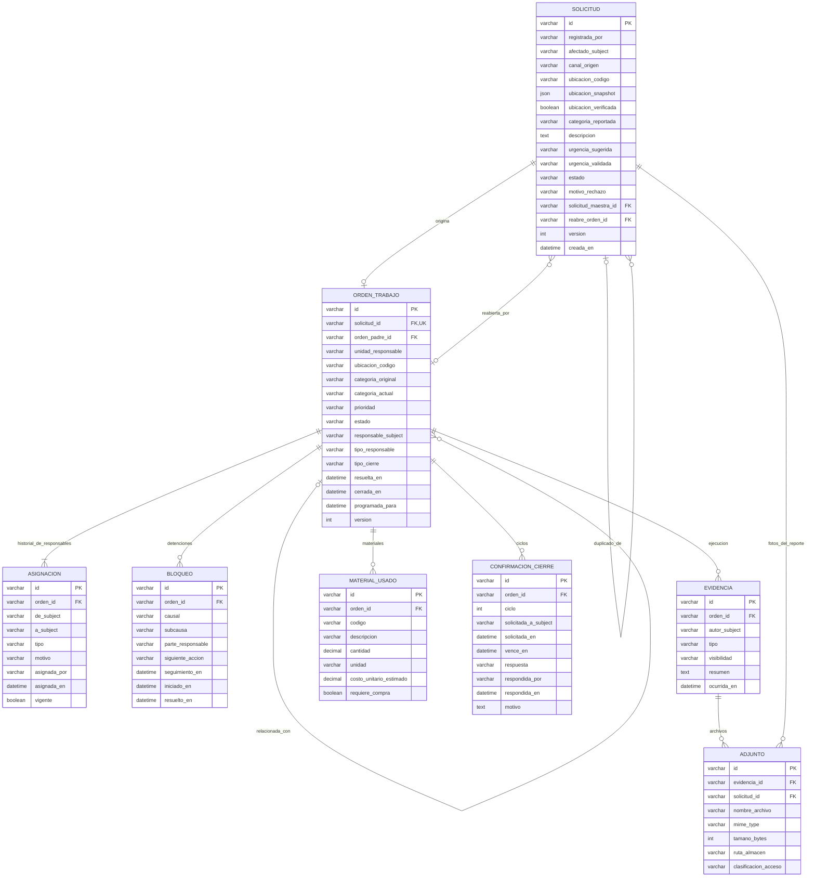

*Figura F11. Modelo lógico del flujo central. Restricciones, nulabilidad y campos adicionales están en el diccionario (6.4); el diagrama no es un script de migración.*

## 6.4 — El diccionario de datos aporta lo que un diagrama ER no dice

| Registro / campo | Significado y regla |
|---|---|
| `solicitud.id`, `orden_trabajo.id` | Identificador legible y estable (`MR-104`, `WO-104`), generado por un contador en la base de datos. Los datos importados del pack conservan su identificador original (`MNT-2001`, `WO-3001`); no se renumeran. |
| `solicitud.registrada_por`, `afectado_subject` | Quien registra y quien sufre el problema; coinciden en un reporte propio. Si registra un tercero (Seguridad por teléfono, el coordinador desde un correo), el afectado se indica o queda vacío y se aplica `ASM-023`. Solo identificadores de sujeto, nunca nombre ni correo. |
| `solicitud.canal_origen` | Correo, teléfono, formulario en papel, mensaje directo, buzón general o web (valores de `source_channel` del pack). Informativo: no cambia el flujo. |
| `solicitud.ubicacion_codigo`, `ubicacion_snapshot`, `ubicacion_verificada` | Código del directorio y copia de sus datos (campus, edificio, piso, espacio, tipo, restringida, activa, fecha de obtención) tomada al reportar (`ASM-017`). `ubicacion_verificada` es falso si el directorio no respondió (`ASM-021`). La copia es inmutable. |
| `solicitud.urgencia_sugerida`, `urgencia_validada` | Dos atributos distintos (BR-02). La validada es nula hasta el triage. Niveles: Crítica, Alta, Normal, Baja (`priority_levels.csv`, `ASM-025`). La urgencia nunca se mezcla con el estado. |
| `solicitud.estado`, `motivo_rechazo` | Los cuatro estados acordados (2.2). `motivo_rechazo` es obligatorio en *Rechazada* (`CHECK`); catálogo: fuera de alcance o información incompleta (`ASM-027`). |
| `solicitud.solicitud_maestra_id` | Solo en *Cerrado (Duplicado)*. No puede ser la propia solicitud (`CHECK`) ni una solicitud que a su vez sea duplicada (guarda de aplicación). |
| `solicitud.reabre_orden_id` | Orden cerrada que originó esta solicitud por reapertura (`ASM-026`); vacío en las demás. |
| `orden_trabajo.solicitud_id` | `UNIQUE`: una solicitud origina a lo sumo una orden. |
| `orden_trabajo.orden_padre_id` | Orden relacionada (por ejemplo `WO-3009`, que espera a `WO-3001`). Relación informativa, no reapertura. |
| `orden_trabajo.categoria_original`, `categoria_actual` | La original no se modifica nunca; la actual cambia con el comando *corregir categoría*, con motivo y auditoría (escenario `DH02-SC-04`). |
| `orden_trabajo.prioridad` | Prioridad vigente. Nace de `urgencia_validada` y solo la cambia el coordinador o el supervisor (BR-02). |
| `orden_trabajo.responsable_subject`, `tipo_responsable` | **`NOT NULL` en todos los estados**: la orden cerrada conserva su último responsable. El tipo es técnico o contratista (`CHECK`). Es la lectura rápida del responsable vigente; el historial está en `asignacion`. |
| `orden_trabajo.tipo_cierre`, `cerrada_en` | `CHECK`: ambos nulos salvo en *Cerrada*, donde ambos son obligatorios (BR-06). |
| `orden_trabajo.resuelta_en` | Instante de la última marca *Resuelta*; origen del plazo de 72 h (2.7). Se reinicia con cada nueva marca. |
| `orden_trabajo.version` | Control optimista (E2-ADR-003). Se incrementa en cada cambio aceptado. |
| `asignacion` | Historial de responsables: inicial, transferencia o reasignación. `motivo` obligatorio salvo en la inicial. Una sola fila `vigente` por orden (6.7). |
| `bloqueo` | Una detención. `causal` obligatoria (acceso o materiales) con `subcausa` de catálogo: acceso requerido, acceso supervisado o llave no disponible (`ASM-024`). A lo sumo un bloqueo sin `resuelto_en` por orden. |
| `evidencia` | Observación, foto o nota del técnico (el equivalente de `work_updates` del pack). `visibilidad` es obligatoria y su valor por defecto es *interna*: el pack tiene una fila en blanco y, ante la duda, se elige la más restrictiva. |
| `adjunto` | Metadatos de un archivo (`ASM-015`). `mime_type` es obligatorio y lo detecta el servidor al subir (el pack tiene un adjunto sin tipo). `evidencia_id` y `solicitud_id` vacíos indican un archivo subido y aún no vinculado (7.4). `clasificacion_acceso`: participantes de la solicitud o restringido. |
| `material_usado` | Justificación de un bloqueo o del trabajo (BR-13). `requiere_compra` es informativo: no inicia ninguna compra. |
| `confirmacion_cierre` | Un ciclo por cada marca *Resuelta* (`UNIQUE(orden_id, ciclo)`). `solicitada_a_subject` es a quien se recuerda; puede responder el afectado o un representante cuyo alcance incluya el edificio (BR-06). `motivo` obligatorio al rechazar (`CHECK`). Respuesta: pendiente, confirmada, rechazada o vencida. |

Reglas generales: las marcas de tiempo son `DATETIME(3)` en UTC (`ASM-013`) y la conexión se abre con zona horaria UTC; no se usa `TIMESTAMP` por su conversión implícita. Los campos de texto tienen límites documentados y los valores obligatorios no se rellenan por defecto en la interfaz. Los campos narrativos no se copian a los registros operativos (6.12).

## 6.5 — V-DATA — Historial, plazos, entregas y datos de referencia son registros distintos

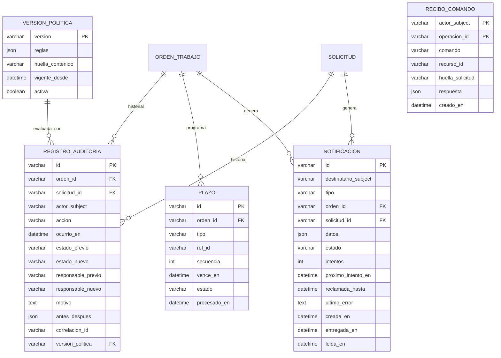

*Figura F12. Un evento de auditoría de negocio no es una notificación, ni un plazo, ni un recibo de comando. `NOTIFICACION.id` es la clave de deduplicación que viaja al adaptador (E2-ADR-005).*

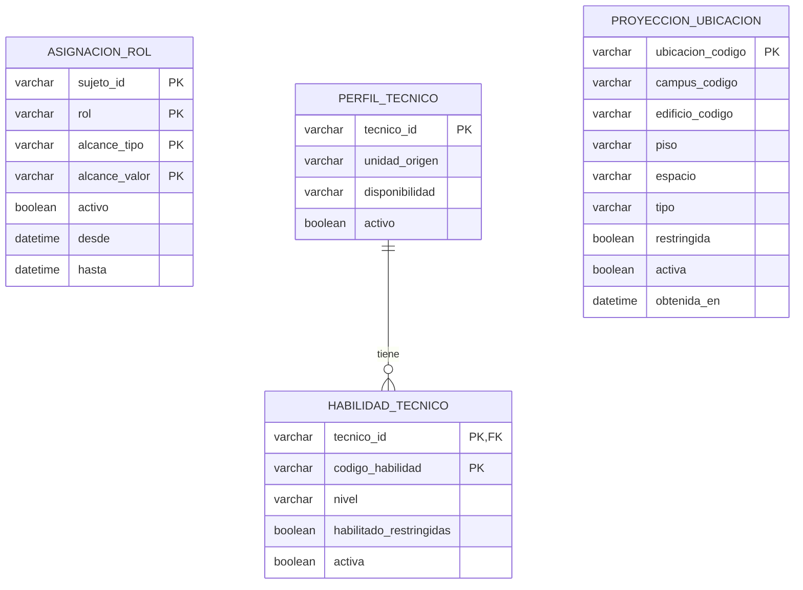

*Figura F13. Datos de personas y ubicaciones que el sistema conserva localmente (5.12): roles con alcance, perfil técnico cargado desde la semilla y la caché de ubicaciones. Los niveles de prioridad, las categorías y el catálogo de unidades viven dentro de `version_politica.reglas` (E2-ADR-006).*

`UNIQUE(plazo.tipo, ref_id, secuencia)` evita programar dos veces el mismo recordatorio o el mismo cierre.

## 6.6 — Del pack del profesor al modelo: cada irregularidad tiene un tratamiento

El pack contiene irregularidades a propósito (`dataset-notes.md`). Esta tabla muestra cómo las trata el modelo; el cargador de semilla debe listarlas en su informe de validación sin modificar los archivos crudos.

| Irregularidad del pack | Registro | Tratamiento en el modelo |
|---|---|---|
| Prioridad mezclada con el estado (`URGENT` como estado, `MNT-2003`) | `solicitud.estado`, `urgencia_*` | Urgencia y estado son atributos independientes. Una orden Crítica tiene metas de revisión y asignación propias (`ASM-025`); aislar el área y cortar la energía es una acción física fuera del sistema, que solo se registra como evidencia de tipo *acción de seguridad*. |
| Duplicado que debe seguir trazable (`MNT-2001` y `MNT-2002`) | `solicitud_maestra_id` | La secundaria queda *Cerrado (Duplicado)* y se cuenta como impacto. La búsqueda de candidatos usa la ubicación y una ventana de tiempo; la categoría solo ordena porque las dos solicitudes del pack tienen categorías distintas. |
| Ubicación incompleta (`MNT-2006`) | `ubicacion_verificada` | Sin código verificado no se crea orden; se rechaza con motivo *información incompleta* (`ASM-027`). |
| Ubicación inactiva con orden activa (`WO-3008`) | `ubicacion_snapshot` | Las órdenes existentes no se revalidan contra el directorio. |
| Categoría corregida tras la inspección (`WO-3003`) | `categoria_original`, `categoria_actual` | Se conservan ambas y el cambio queda auditado con su motivo. |
| Reasignación a un especialista (`ASN-5004`) | `asignacion` | Historial completo de responsables; solo uno vigente. |
| Asignación obsoleta (`TECH-007` inactivo en `WO-3006`) | `perfil_tecnico.activo` | Las órdenes cuyo responsable está inactivo se listan para reasignación. No se asigna a un técnico inactivo. |
| Asignación sin motivo (`ASN-5010`) | `asignacion.motivo` | La importación lo marca como advertencia; en el sistema nuevo el motivo es obligatorio salvo en la asignación inicial. |
| Bloqueo sin causal (`BLK-7004`) | `bloqueo.causal` | `NOT NULL`. La espera por una orden relacionada se representa con `orden_padre_id` (`ASM-024`). |
| Finalización técnica sin cierre (`WO-3004`) | `estado`, `confirmacion_cierre` | *Resuelta* y *Cerrada* son estados distintos con un ciclo de confirmación. |
| Reapertura tras la confirmación (`WO-3006`) | `reabre_orden_id` | Solicitud nueva vinculada; la orden cerrada conserva su evidencia y su cierre (`ASM-026`). |
| Adjunto sin tipo MIME (`ATT-9003`) | `adjunto.mime_type` | Obligatorio; lo detecta el servidor. |
| Visibilidad en blanco (`UPD-6012`) | `evidencia.visibilidad` | Obligatoria, con valor por defecto *interna*. |
| Confirmación sin fecha de solicitud (`CNF-10003`) | `confirmacion_cierre` | `solicitada_en` obligatoria; la importación lo marca como advertencia. |

## 6.7 — Cada invariante se asigna al mecanismo que realmente la hace cumplir

| Invariante | Mecanismo principal | Evidencia de apoyo |
|---|---|---|
| **BR-04** Una orden activa tiene exactamente un responsable | `responsable_subject NOT NULL`; en `asignacion`, una columna generada que vale `orden_id` si la fila es vigente y nulo si no, con índice único (a lo sumo una vigente); el cambio de responsable actualiza la orden y las dos filas de `asignacion` en una sola transacción | Prueba con dos conexiones (QS-01); consulta de verificación: ninguna orden con cero o dos asignaciones vigentes. |
| Una solicitud origina a lo sumo una orden | `UNIQUE(orden_trabajo.solicitud_id)` | Prueba de creación doble de la orden. |
| **BR-06** Tipo de cierre coherente con el estado | `CHECK` sobre estado, `tipo_cierre` y `cerrada_en` (MySQL 8.0.16 o superior, `ASM-018`) | Prueba negativa de una fila inválida; comprobación de versión al arrancar. |
| **BR-05** El técnico no cierra | Tabla de transiciones: *Resuelta → Cerrada* solo admite al afectado, al representante o al sistema | Matriz de QS-04. |
| **QS-02** Un solo cierre | `UPDATE … WHERE id = ? AND estado = 'Resuelta' AND version = ?`; la fila afectada decide quién gana | Dos ejecuciones concurrentes contra MySQL real. |
| **BR-07** Rechazar exige motivo | `CHECK` en `confirmacion_cierre` (rechazada implica motivo) y guarda de aplicación | Prueba de rechazo sin motivo. |
| **BR-08** Un bloqueo exige causal | `causal NOT NULL` y columna generada con índice único para un solo bloqueo abierto por orden | Intento de bloquear sin causal; doble bloqueo. |
| **BR-09** Evidencia según la transición | Guarda de aplicación con la política vigente (no se expresa como restricción de base de datos) | Prueba por transición y regresión de política (QS-05). |
| **BR-10**, QS-03 Historial inmutable | Se escribe en la misma transacción; el usuario de base de datos de la aplicación no tiene permisos `UPDATE` ni `DELETE` sobre `registro_auditoria`; disparadores `BEFORE UPDATE` y `BEFORE DELETE` que lanzan error como defensa adicional | Intento de edición directa con el usuario de la aplicación. No protege frente a un administrador de la base de datos. |
| **BR-12** Autorización en el servidor | Autorización antes de abrir la transacción y verificación de alcance y estado dentro de ella | Matriz negativa de QS-04. |
| Notificación sin duplicados visibles | `notificacion.id` como clave de deduplicación hacia el adaptador; `UNIQUE` en `plazo` | Inyección de fallos y reinicio (QS-07). |
| QS-06 Comando repetido | Clave primaria `(actor_subject, operacion_id)` en `recibo_comando`, dentro de la misma transacción | Tres reenvíos del mismo comando. |
| La copia de ubicación no cambia | No existe ningún comando que actualice `ubicacion_snapshot` | Revisión de rutas de escritura. |
| Personas y ubicaciones válidas | Sin claves foráneas hacia sistemas externos: el adaptador valida al escribir (identidad al iniciar sesión; ubicación al reportar y al crear la orden) | Pruebas de contrato (QS-10). |

Ningún diagrama, prueba o restricción demuestra por sí solo toda la arquitectura.

## 6.8 — V-STATE-SOL — Ciclo de vida de la solicitud

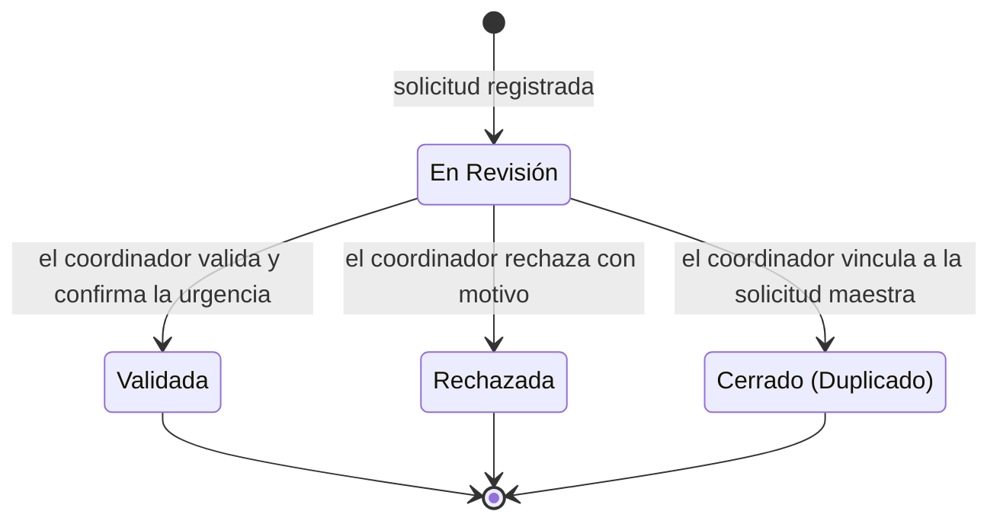

*Figura F14. Estados de la solicitud. La solicitud termina en uno de tres estados y no cambia después; el trabajo continúa en la orden.*

| Transición | Actor y guarda | Efectos confirmados juntos |
|---|---|---|
| Registrar | Usuario autenticado, o coordinador o Seguridad en nombre de un tercero. La ubicación existe y está activa o el directorio no responde (`ASM-021`); categoría del catálogo | Solicitud, copia de la ubicación, auditoría y notificación al solicitante. |
| En Revisión → Validada | Coordinador con alcance; ubicación verificada; urgencia validada informada; versión vista coincide | Urgencia validada y versión de política registradas, auditoría, notificación. |
| En Revisión → Rechazada | Coordinador; motivo obligatorio | Motivo, auditoría, notificación. |
| En Revisión → Cerrado (Duplicado) | Coordinador; la maestra existe, no es duplicada y comparte la ubicación (BR-03) | Referencia a la maestra, auditoría y notificación con el identificador de la maestra. |

## 6.9 — V-STATE-ORD — Ciclo de vida de la orden de trabajo

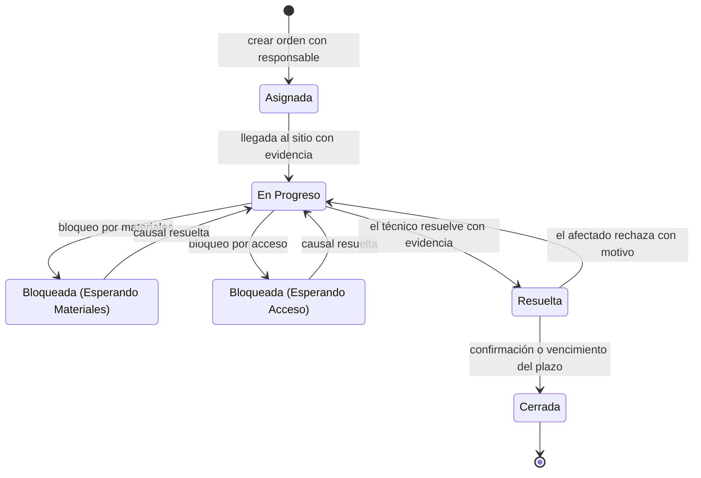

*Figura F15. Estados de la orden. La transferencia y la reasignación no son estados: ocurren dentro de Asignada, En Progreso y Bloqueada sin cambiar el estado.*

| Transición | Actor y guarda | ¿Evidencia? (matriz de 2.5) | Efectos confirmados juntos |
|---|---|---|---|
| ∅ → Asignada | Coordinador o supervisor con alcance; solicitud Validada sin orden; responsable activo; ubicación verificada, activa y con datos de menos de 5 minutos; advertencia reconocida si el técnico no está habilitado (`ASM-022`) | No aplica | Orden, asignación inicial vigente, auditoría, notificación al solicitante y al responsable. |
| Asignada → En Progreso | Responsable | Sí | Auditoría, notificación al solicitante. |
| En Progreso → Bloqueada | Responsable; causal obligatoria | Sí | Bloqueo abierto con parte responsable y fecha de seguimiento, auditoría, notificación al supervisor y al solicitante (BR-08, BR-11). |
| Bloqueada → En Progreso | Responsable; la parte que desbloquea puede ser otra persona (el representante concede el acceso, `ASM-024`) | Opcional | `resuelto_en` del bloqueo, auditoría, notificación. |
| En Progreso → Resuelta | Responsable | Sí (observaciones y foto) | `resuelta_en`, ciclo de confirmación con `vence_en` a 72 h, plazos de recordatorio a las 24 h y 48 h y de cierre a las 72 h, auditoría, notificación al afectado. |
| Resuelta → En Progreso | Afectado o representante con alcance; motivo obligatorio | No | Ciclo rechazado, plazos del ciclo cancelados, mismo responsable, auditoría, notificación al técnico y al supervisor. |
| Resuelta → Cerrada (Confirmado) | Afectado o representante con alcance | No | Tipo de cierre, plazos cancelados, auditoría, notificación al solicitante y al supervisor. |
| Resuelta → Cerrada (Automático) | Sistema; `ahora ≥ resuelta_en + 72 h`, estado *Resuelta*, versión leída; regla de recuperación de `ASM-028` | No | Tipo de cierre, auditoría con actor *Sistema*, notificación al afectado con opción de reapertura. |

La «oportunidad documentada» de SC-05 se cumple cuando la orden aparece en el apartado de pendientes del afectado desde `resuelta_en` y los recordatorios quedan registrados, aunque su entrega externa falle (`ASM-011`).

**Comandos que no cambian el estado de la orden**

| Comando | Actor y guarda | Efecto |
|---|---|---|
| Transferir | Responsable; estados Asignada, En Progreso o Bloqueada; destino activo y distinto; motivo obligatorio; evidencia opcional | Nueva asignación vigente, aviso al supervisor (`ASM-009`). |
| Reasignar | Supervisor; mismos estados; motivo obligatorio | Nueva asignación vigente, aviso al técnico anterior y al nuevo. |
| Corregir categoría | Responsable, coordinador o supervisor; motivo obligatorio | Cambia `categoria_actual`; la original queda intacta. |
| Cambiar prioridad | Coordinador o supervisor; motivo obligatorio (BR-02) | Cambia `prioridad` y las metas de la orden. |
| Reabrir | Afectado o representante; orden *Cerrada* con `cerrada_en` de menos de 48 h (`ASM-007`) | Crea una solicitud *En Revisión* vinculada (`ASM-026`); la orden no cambia. |

La tabla de transiciones es la de E2-ADR-002: cada fila es una prueba de transición válida y toda combinación no listada (por ejemplo *Cerrada → cualquiera* o *Asignada → Resuelta*) es una prueba de transición prohibida.

## 6.10 — Tres dimensiones de estado independientes evitan interfaces engañosas

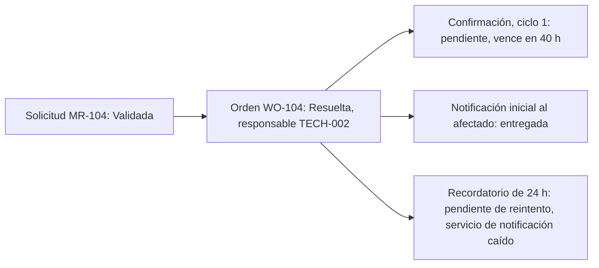

*Figura F16. Combinación legítima: la orden está resuelta, la confirmación sigue abierta y una notificación está retrasada.*

La interfaz muestra cada dimensión por separado: el avance de solicitud y orden, el ciclo de confirmación con su plazo, y el estado de entrega de las notificaciones. Un fallo de entrega no se presenta como un fallo de la orden, y una orden *Resuelta* no se presenta como cerrada.

## 6.11 — V-TXN — Qué entra en un comando atómico

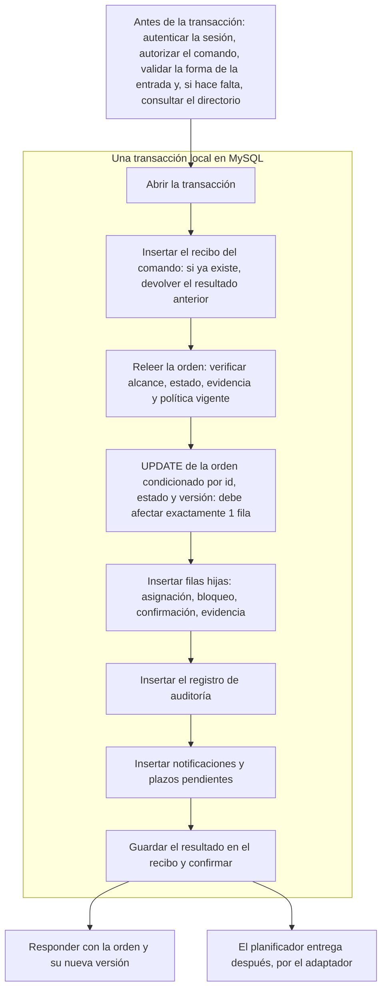

*Figura F17. Frontera de atomicidad. La autenticación y la autorización inicial ocurren antes de tocar el recibo; el alcance y el estado se vuelven a comprobar dentro de la transacción.*

- Si cualquier sentencia falla, se deshace todo, **incluido el recibo**. Por eso un reintento con la misma `operacion_id` vuelve a ejecutarse y la presencia del recibo prueba que la transacción se confirmó.
- La condición de versión del `UPDATE` decide los conflictos; el diseño no depende del nivel de aislamiento por defecto (E2-ADR-009).
- Las sentencias se emiten siempre en el mismo orden (orden, filas hijas, auditoría, notificaciones y plazos) para reducir los bloqueos mutuos. Si InnoDB detecta uno, la aplicación reintenta una sola vez de forma interna.
- Los diagnósticos de comandos rechazados van al registro operativo y de seguridad; nunca se presentan como un evento de auditoría de negocio confirmado.
- Las llamadas HTTP a servicios externos quedan **fuera** de la transacción.

## 6.12 — El ciclo de vida de los datos y las migraciones también forman parte del diseño

| Preocupación | Regla de diseño |
|---|---|
| Solicitudes y órdenes | No se borran. Las rechazadas y las duplicadas se conservan. |
| Historial de auditoría | Solo se anexa; en la demostración no se borra. No protege frente a un administrador de la base de datos. |
| Evidencias y adjuntos | Se conservan con la orden. Un adjunto subido y nunca vinculado, con más de 24 h, lo elimina una tarea de limpieza y queda en el registro operativo. |
| Recibos de comando | Propuesta: 7 días, más que el ejemplo de la guía porque un técnico puede reenviar un borrador horas después. Pasado ese plazo, un reenvío se trata como un comando nuevo y la versión lo frena. |
| Notificaciones | Se conservan las pendientes y las fallidas; archivar las entregadas requiere una política por definir. |
| Ubicaciones | La proyección local es una caché reconstruible. Para crear una orden se exige una edad máxima de 5 minutos; en lectura puede mostrarse hasta 24 h marcada como no refrescada (valores propuestos). No es fuente histórica: lo es la copia guardada en la solicitud. |
| Datos personales | Solo datos sintéticos. El historial guarda identificadores de sujeto, no nombre ni correo; los nombres se resuelven al mostrar y, si el servicio de identidad no responde, se muestra el identificador. Los técnicos tienen nombre en su perfil local. No se infiere cumplimiento legal. |
| Migraciones | Scripts pequeños, versionados y reversibles. En MySQL las sentencias que cambian el esquema confirman de forma implícita: cada migración lleva verificación previa y un script de recuperación. Al arrancar se comprueba que el servidor sea 8.0.16 o superior y que un `CHECK` rechace un dato inválido (`ASM-018`). |
| Carga de semilla | No modifica los archivos crudos; las transformaciones van a `data/generated/` y el informe de validación lista las irregularidades de 6.6. |
| Respaldo | Reiniciar el contenedor con un volumen persistente no es lo mismo que recuperarse de la pérdida de la base de datos. La demostración cubre solo lo primero; lo segundo queda como trabajo pendiente (ver «Alcance de esta entrega»). |

Una revisión de arquitectura debe identificar qué se puede borrar, quién puede hacerlo y qué evidencia se perdería.

---

# 7. Interacciones críticas y comportamiento ante fallos

Las secuencias recorren el escenario de 2.6 y muestran las decisiones de las secciones 4 a 6 en funcionamiento. Todas están en estado **DISEÑADO**. Los intentos de concurrencia deben probarse con conexiones independientes contra MySQL real: un repositorio simulado en memoria no valida estos riesgos.

## 7.1 — V-SEQ-01 — Reportar con una ubicación del directorio y hacer el triage

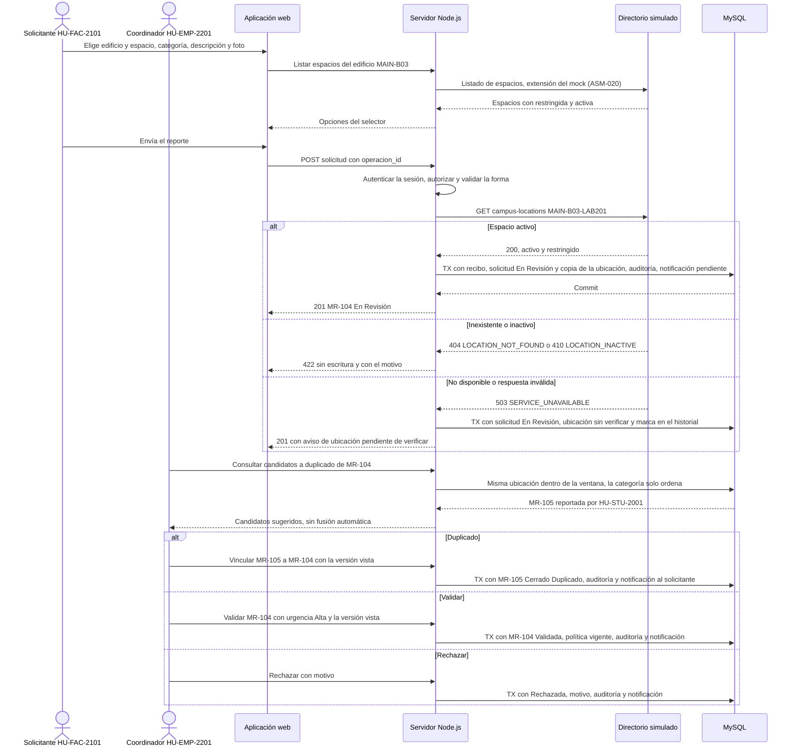

*Figura F18. Al final de esta secuencia no existe ninguna orden: la solicitud validada todavía no tiene responsable (CL-001).*

- Si el directorio no responde, el selector se llena con la proyección local, marcada como no refrescada.
- **Ventana de duplicados.** Configurable, con 24 horas como valor inicial propuesto. `MNT-2001` y `MNT-2002` del pack usan categorías y nombres de edificio distintos: el código de ubicación elimina el problema de los nombres y la categoría no puede ser una condición obligatoria.
- **Reporte en una ubicación restringida.** El sistema no impide reportarla; la restricción afecta a la asignación (7.2).

## 7.2 — V-SEQ-02 — Crear la orden y asignar un responsable explícito

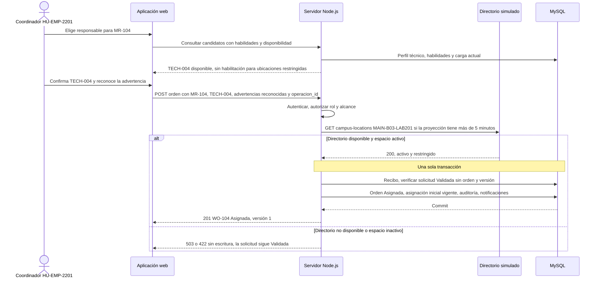

*Figura F19. Crear la orden falla cerrado si no hay datos de ubicación utilizables; recibir el reporte, en cambio, no (`ASM-021`).*

- Dos coordinadores que crean la orden de la misma solicitud a la vez chocan con `UNIQUE(solicitud_id)`: la segunda recibe un conflicto de orden ya existente y no se escribe nada.
- Sin la advertencia reconocida, la orden no se crea y la respuesta lista las advertencias pendientes.

## 7.3 — V-SEQ-03 — Dos cambios de responsable a la vez (QS-01)

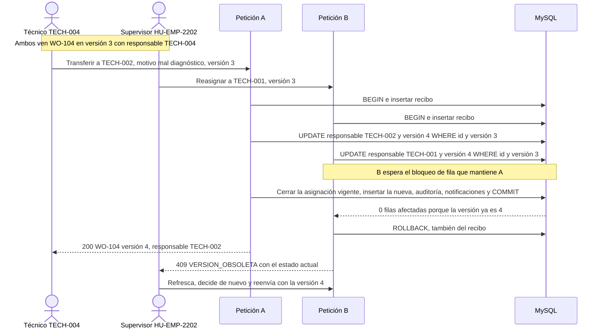

*Figura F20. Una posible intercalación. Cuál petición gana no está especificado; lo que se garantiza es la integridad: un solo cambio confirmado, ninguna orden sin responsable y un registro de auditoría por cambio aceptado.*

El choque nunca deja la orden sin responsable ni con dos: el `UPDATE` de la orden y los cambios de `asignacion` están en la misma transacción (BR-04, 6.7).

## 7.4 — V-SEQ-04 — Bloqueo desde el campo con reenvíos (QS-06)

```mermaid
sequenceDiagram
    actor T as Técnico TECH-002
    participant UI as Aplicación web móvil
    participant API as Servidor Node.js
    participant FS as Almacén de adjuntos
    participant DB as MySQL
    T->>UI: Registra un bloqueo por acceso con foto, en un sótano
    UI->>UI: Guarda el borrador local con operacion_id y versión vista
    UI->>API: Subir la foto
    API->>FS: Guardar el archivo
    API->>DB: Insertar el adjunto sin evidencia, con el tipo MIME detectado
    API-->>UI: adjunto_id
    UI->>API: POST bloqueo con adjunto_id y operacion_id, intento 1
    API->>DB: TX con recibo, orden Bloqueada Esperando Acceso, bloqueo, evidencia, auditoría y aviso al supervisor
    DB-->>API: Commit
    API--xUI: La respuesta se pierde por falta de señal
    UI->>API: Intento 2 con la misma operacion_id
    API->>DB: El recibo ya existe con la misma huella
    API-->>UI: 200 con el mismo resultado, marcado como repetido
    UI->>API: Intento 3 con la misma operacion_id
    API-->>UI: 200 con el mismo resultado, sin nuevo cambio ni nuevo registro de auditoría
    UI->>UI: Borra el borrador local
```

*Figura F21. El borrador local conserva la intención del técnico; el servidor aplica el comando una sola vez.*

- Una `operacion_id` reutilizada con un contenido distinto se rechaza (la huella no coincide) y no devuelve el resultado anterior.
- Subir el archivo y registrar el comando son pasos separados: el comando solo cita un `adjunto_id` ya existente. Una subida repetida no crea duplicados (misma huella de contenido) y un archivo nunca vinculado se elimina en la limpieza de 6.12.
- Alcance: esto **no** es operación sin conexión (`ASM-004`). Sin señal no se carga información nueva.

## 7.5 — V-SEQ-05 — Resolver, recordar y la carrera de cierre (QS-02)

```mermaid
sequenceDiagram
    actor T as Técnico TECH-002
    actor F as Afectado HU-FAC-2101
    participant API as Servidor Node.js
    participant DB as MySQL
    participant P as Planificador
    T->>API: Resolver WO-104 con observaciones y foto, versión 5
    API->>DB: TX con orden Resuelta, ciclo 1, plazos de 24 h, 48 h y 72 h, auditoría y notificación
    API-->>T: 200 Resuelta, versión 6
    Note over DB,P: A las 24 h y 48 h salen los recordatorios y a las 72 h vence el plazo
    par El afectado confirma
        F->>API: Confirmar el cierre con la versión 6
        API->>DB: UPDATE a Cerrada Confirmado WHERE estado Resuelta y versión 6
    and El planificador cierra por vencimiento
        P->>DB: Leer el plazo vencido y la versión 6 de la orden
        P->>API: Cerrar por vencimiento, actor Sistema, versión 6
        API->>DB: UPDATE a Cerrada Automático WHERE estado Resuelta y versión 6
    end
    Note over API,DB: El motor serializa los dos UPDATE y solo uno afecta una fila
    alt Gana la confirmación
        API-->>F: 200 Cerrada, tipo Confirmado
        API->>DB: Plazo marcado como procesado, sin auditoría adicional
    else Gana el planificador
        API-->>F: 409 ORDEN_YA_CERRADA con tipo Automático y opción de reapertura
    end
```

*Figura F22. El planificador no cierra por su cuenta: pide el cierre bajo la misma condición de versión que una confirmación humana (F08). Resultado: exactamente un cierre y un registro de auditoría.*

Si la confirmación llega después del cierre automático, el afectado ve el cierre automático y puede reabrir dentro de las 48 h (7.7); no se reescribe el tipo de cierre.

## 7.6 — V-SEQ-06 — Un servicio de notificación caído y un reinicio no pierden nada (QS-07)

```mermaid
sequenceDiagram
    participant API as Servidor Node.js
    participant DB as MySQL
    participant P as Planificador
    participant ADP as Adaptador de notificación
    participant NOT as Servicio de notificación simulado
    API->>DB: Confirmar el cambio de estado con la notificación Pendiente
    API-->>API: Responder al usuario sin esperar la entrega
    P->>DB: Reclamar pendientes vencidos con reclamada_hasta en 30 s
    P->>ADP: Enviar con la clave igual al id de la notificación
    ADP->>NOT: Solicitud
    NOT--xADP: Sin respuesta durante 2 minutos
    P->>DB: Intentos más 1, próximo intento con espera de 5, 10, 20 y luego 30 s, error sanitizado
    Note over API,P: La aplicación se reinicia durante la caída
    P->>DB: Al arrancar, retomar las pendientes y los reclamos vencidos
    NOT-->>ADP: El servicio se restablece
    P->>ADP: Reintento con la misma clave
    ADP->>NOT: Solicitud
    NOT-->>ADP: Aceptada
    P->>DB: Marcar Entregada si el reclamo sigue vigente
```

*Figura F23. La entrega es al menos una vez; la clave de deduplicación evita duplicados visibles si el receptor la respeta (E2-ADR-005).*

```mermaid
stateDiagram-v2
    [*] --> Pendiente
    Pendiente --> Pendiente : fallo temporal con presupuesto de reintentos disponible
    Pendiente --> Entregada : el adaptador acepta
    Pendiente --> Fallida : error permanente o presupuesto agotado
    Fallida --> Pendiente : reintento manual de un operador con motivo
    Entregada --> [*]
```

*Figura F24. Estados de entrega de una notificación (los tres de 5.5, más el reintento manual).*

**Valores propuestos para la demostración**, aún no medidos: sondeo del planificador cada 5 s; esperas de reintento de 5, 10, 20 y luego 30 s; 20 intentos como presupuesto (unos 10 minutos de caída tolerada); reclamo de 30 s. Con una caída de 2 minutos, el primer intento posterior al restablecimiento ocurre en 30 s como máximo, dentro de la meta de 60 s de QS-07. La bandeja de la aplicación lee directamente las filas de notificación y no depende de la entrega externa.

**Regla de recuperación (`ASM-028`).** Tras una caída larga de la aplicación, el planificador no cierra de inmediato las órdenes vencidas durante la caída: primero emite los recordatorios pendientes y reprograma el cierre 24 horas después.

## 7.7 — V-SEQ-07 — Reapertura sin reescribir el pasado

```mermaid
sequenceDiagram
    actor F as Afectado HU-FAC-2101
    actor C as Coordinador HU-EMP-2201
    participant API as Servidor Node.js
    participant DB as MySQL
    F->>API: Reabrir WO-104 con motivo y versión 7
    API->>API: Autorizar al afectado o representante y comprobar que siguen menos de 48 h
    API->>DB: TX con MR-120 En Revisión que reabre WO-104, copia de la ubicación, auditoría en ambas y notificaciones
    DB-->>API: Commit
    API-->>F: 201 MR-120 vinculada a WO-104
    Note over DB: WO-104 sigue Cerrada y sin cambios, con su evidencia y su tipo de cierre
    C->>API: Hacer el triage de MR-120 con el historial de WO-104 visible
```

*Figura F25. La reapertura crea una solicitud vinculada que vuelve a pasar por el triage (`ASM-026`, F02).*

## 7.8 — Una matriz de fallos hace revisables las afirmaciones de arquitectura

| Punto de fallo | Resultado durable requerido | Resultado para el usuario o el operador |
|---|---|---|
| Comando inválido o no autorizado | Ninguna escritura de negocio | Error 4xx definido; registro operativo y de seguridad. |
| Versión obsoleta | Rollback completo, incluido el recibo | 409 `VERSION_OBSOLETA` con el estado actual; el usuario refresca (QS-01). |
| Transición inválida, evidencia o motivo ausentes | Ninguna escritura | 409 o 422 con la acción de recuperación. |
| Mismo comando repetido (`operacion_id` igual) | Un solo cambio y un solo registro | El resultado anterior, marcado como repetido (QS-06). |
| `operacion_id` reutilizada con otro contenido | Ninguna escritura | 422 `OPERACION_REUTILIZADA`. |
| Confirmación y cierre automático a la vez | Un solo cierre; el tipo es el de la operación ganadora | La otra recibe «ya cerrada» (QS-02). |
| Caída de MySQL antes del commit | Ningún éxito reconocido | 503; el borrador del técnico sigue en el dispositivo. |
| Commit exitoso y respuesta perdida | Cambio y recibo existen | El reintento devuelve el resultado registrado. |
| Resultado del commit desconocido | El recibo vive en la misma transacción: si existe, se confirmó; si no, no | Reintentar con la misma `operacion_id`. |
| Directorio: 404 o 410 al reportar | Ninguna escritura | 422 con el motivo. Las órdenes existentes no se afectan (`ASM-021`). |
| Directorio: 503 o respuesta inválida al reportar | Solicitud con ubicación sin verificar | Aviso al solicitante; el coordinador debe verificarla. |
| Directorio: 503 al crear la orden | Ninguna escritura | 503; la solicitud sigue Validada y se reintenta. |
| Identidad no disponible | Sin cambios de datos | No se pueden abrir sesiones nuevas; las vigentes siguen hasta expirar porque los roles son locales; los nombres se muestran como identificador. |
| Servicio de notificación caído | Estado confirmado; notificación Pendiente | Entrega diferida con reintentos (QS-07). |
| Planificador cae antes de enviar | La notificación sigue pendiente | Se reclama de nuevo al vencer el reclamo. |
| Planificador cae después de enviar | El receptor pudo aplicar el efecto | Reintento con la misma clave; el receptor deduplica. Si no lo hiciera, quedaría un duplicado documentado como riesgo residual. |
| Aplicación caída durante varios días | Plazos vencidos sin procesar | Recordatorios atrasados y cierre reprogramado 24 h (`ASM-028`). |
| Bloqueo mutuo en MySQL | Una de las transacciones se deshace | Un reintento interno único; si falla, 503. |
| Adjunto subido y comando nunca enviado | Archivo huérfano | Limpieza tras 24 h (6.12). |
| Responsable inactivo en una orden activa (`WO-3006`) | Sin cambios automáticos | Aparece en la lista de reasignación del supervisor. |

Cada fila necesita una prueba, una inspección o una brecha de validación reconocida explícitamente.

## 7.9 — Qué permiten probar estas secuencias

| Secuencia | Escenario de calidad | Prueba objetivo | Estado |
|---|---|---|---|
| V-SEQ-03 | QS-01 | Dos conexiones independientes sobre MySQL: exactamente una tiene éxito | DISEÑADO |
| V-SEQ-05 | QS-02 | Confirmación y cierre automático simultáneos: un cierre y un registro | DISEÑADO |
| V-SEQ-04 | QS-06 | Tres reenvíos de un comando: un cambio y un registro | DISEÑADO |
| V-SEQ-06 | QS-07 | Servicio de notificación caído y reinicio: nada se pierde | DISEÑADO |
| V-SEQ-01, V-SEQ-02 | QS-10 | Pruebas de contrato del adaptador con 200, 404, 410 y 503 | DISEÑADO |
| Matriz 7.8 | QS-04, QS-03 | Matriz negativa de autorización; intento de edición del historial | DISEÑADO |

Ninguna fila está implementada ni verificada en esta versión. La prueba de concepto propuesta en 1.2 puede recorrer V-SEQ-01 a V-SEQ-05; qué se ejecute realmente se registrará en la validación de una etapa posterior.
