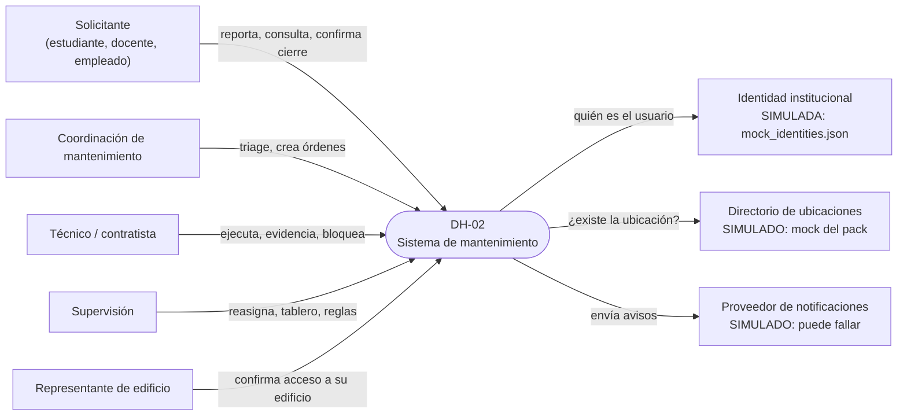
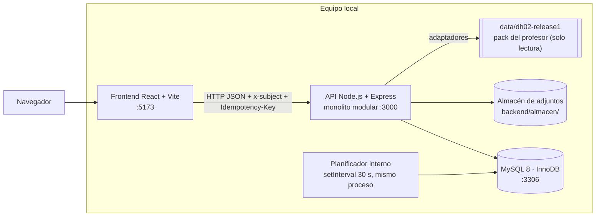
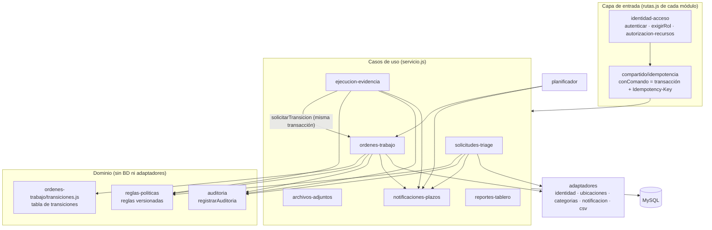
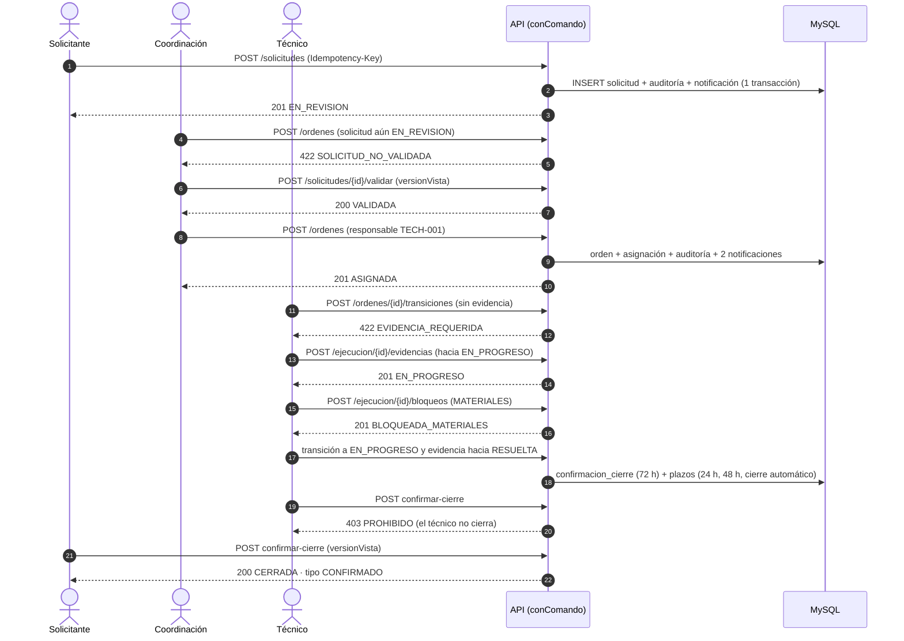
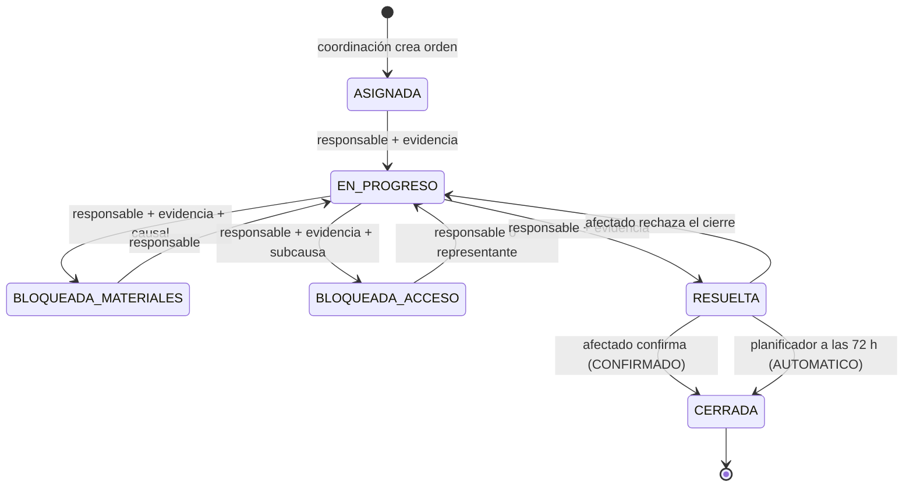
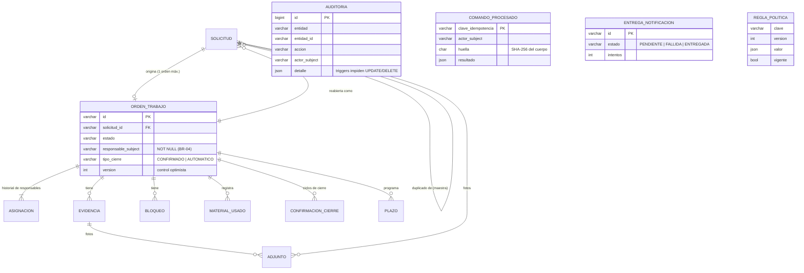

# Evaluación 3 · Arquitectura actualizada (diseño real del primer incremento)

**Proyecto:** DH-02 · Sistema de Mantenimiento y Órdenes de Trabajo · Horizon University
**Equipo:** Hernán Mundell, David Gutierrez, Mike Buelvas
**Versión del incremento:** `v0.3.0` (rama `docs/contratos-modulos` + Fase 2/3) · 8 de noviembre de 2026
**Documento base:** [`../eva2final.md`](../eva2final.md) (Evaluación 2). Este documento **no lo repite**: muestra solo lo que cambió y cómo quedó el software que existe hoy.

> Convención de estado usada en todo el paquete:
> **VERIFICADO** = hay código y una prueba automática que lo demuestra · **IMPLEMENTADO** = hay código, probado solo a mano · **SIMULADO** = existe detrás de un adaptador falso · **DISEÑADO** = solo en el documento · **PENDIENTE** = no existe.

---

## 1. Qué funciona hoy (alcance del incremento)

El caso de uso implementado de extremo a extremo es el **flujo central de la sección 1.2 / 2.8** de la Evaluación 2:

```
Reportar daño → Triage (validar / duplicado / rechazar) → Crear orden con responsable explícito
→ Ejecutar con evidencia → Bloqueo y desbloqueo → Resolver → Confirmar o rechazar el cierre (o cierre automático a las 72 h)
```

| Capacidad (RF) | Estado | Dónde se demuestra |
|---|---|---|
| RF-01 Registrar solicitud con ubicación, categoría y foto | **VERIFICADO** | `integracion/flujos.spec.js` · E2E |
| RF-02 Consultar mis solicitudes y notificaciones | IMPLEMENTADO | Pantalla Solicitante + bandeja de notificaciones |
| RF-03 Validar / rechazar en triage | **VERIFICADO** | E2E + prueba 403 |
| RF-04 Sugerir y vincular duplicados | IMPLEMENTADO | Pantalla Coordinador (verificado a mano en `docs/fase-1.md`) |
| RF-05 Crear orden desde solicitud validada con responsable | **VERIFICADO** | E2E (incluye rechazo 422 si no está validada) |
| RF-06 Bandeja del técnico | **VERIFICADO** | E2E |
| RF-07 Transiciones con evidencia y bloqueos con causal | **VERIFICADO** | E2E (incluye rechazo 422 sin evidencia) |
| RF-08 Transferir / reasignar con concurrencia | **VERIFICADO** | Prueba QS-01 |
| RF-09 Confirmar / rechazar cierre y cierre automático | **VERIFICADO** | E2E + prueba de rechazo + prueba QS-02 |
| RF-10 Reabrir un caso cerrado | IMPLEMENTADO | Verificado a mano (`docs/fase-1.md`) |
| RF-11 Historial inmutable | **VERIFICADO** | E2E (reconstrucción) + prueba BR-12 (trigger) |
| RF-12 Tablero operativo | IMPLEMENTADO | Pantalla Supervisor |
| RF-13 Identidad simulada + autorización por rol y relación | **VERIFICADO** | Prueba QS-04 + `test/autorizacion-recursos.test.js` |

Servicios externos (**SIMULADOS** detrás de adaptadores): identidad (`mock_identities.json`), directorio de ubicaciones (mock del pack), proveedor de notificaciones (puede “caerse” a propósito).

---

## 2. Vista de contexto (V-CTX) — sin cambios de fondo



**Cambio respecto a E2:** se agregó el **Representante de edificio** como actor con pantalla propia (desbloquea órdenes `BLOQUEADA_ACCESO` de su edificio). En E2 aparecía solo como participante del cierre.

---

## 3. Vista de contenedores (V-CONT) — como se ejecuta hoy



| Contenedor | Tecnología real | Cambio respecto a E2 |
|---|---|---|
| Frontend | React 18 + Vite 8, sin enrutador; selector de usuario simulado | Igual. Se agregó página **Representante** y componente **Notificaciones**. |
| API | Node.js 22, Express 4, `zod` para validar entradas, `mysql2` | Igual (E2-ADR-001, E2-ADR-009). |
| Planificador | Mismo proceso que la API, cada 30 s | **Refinado:** en E2 era un “proceso interno” sin frecuencia; ahora es un ciclo de 30 s que procesa plazos, entregas y adjuntos huérfanos. |
| Base de datos | MySQL 8.0 (Docker en desarrollo) | Igual. |
| Almacén de adjuntos | Carpeta local con nombre UUID | **Nuevo contenedor:** E2 decía “almacenamiento de adjuntos” sin decidir dónde. |
| Pack DH-02 | Archivos JSON/CSV leídos por adaptadores | **Nuevo:** E2-ADR-010 refinado (ver decisiones). |

---

## 4. Vista de componentes (V-COMP) — módulos reales y dónde viven las reglas



**Dónde vive cada regla importante (respuesta directa a “la regla está en la capa adecuada”):**

| Regla | Archivo | Capa |
|---|---|---|
| Transiciones válidas y quién puede hacerlas (BR-05) | `backend/src/modulos/ordenes-trabajo/transiciones.js` | Dominio puro (no importa BD) |
| Evidencia obligatoria por transición (matriz configurable) | `regla_politica.matriz_evidencia` + `ordenes-trabajo/servicio.js` | Política versionada |
| “Solo órdenes desde solicitudes validadas” y “toda orden tiene responsable” (BR-03/BR-04) | `ordenes-trabajo/servicio.js · crearOrden` + `NOT NULL` en `orden_trabajo.responsable_subject` | Servicio + BD |
| Control de concurrencia (E2-ADR-003) | `UPDATE … WHERE version = ?` + `SELECT … FOR UPDATE` en cada comando | Servicio + BD |
| Auditoría inmutable (BR-12) | `auditoria/index.js` + triggers `trg_auditoria_inmutable_*` | Servicio + BD |
| Idempotencia (QS-06) | `compartido/idempotencia.js` + tabla `comando_procesado` | Transversal |
| Autorización por rol, alcance y relación (RF-13) | `identidad-acceso/autorizacion-recursos.js` | Entrada, consultada por cada servicio |

La interfaz **no decide** estas reglas: solo hace validaciones de formulario (por ejemplo, observación vacía) y muestra los errores que devuelve la API. Toda regla de negocio se vuelve a comprobar en el servidor. La frontera entre módulos se verifica con `npm run deps:check` (dependency-cruiser): **0 violaciones, 49 módulos, 138 dependencias**.

---

## 5. Secuencia del caso de uso implementado y sus errores (V-SEQ)



Errores relevantes cubiertos por pruebas: `401` sin identidad, `403` acción no permitida, `409 CONFLICTO_VERSION` en concurrencia, `409 CLAVE_IDEMPOTENCIA_REUTILIZADA`, `422` transición inválida o solicitud no validada.

---

## 6. Estados de la orden (V-STATE-ORD) — igual a E2, ahora ejecutable



La tabla vive en `transiciones.js`; `test/transiciones.test.js` prueba cada fila válida y combinaciones prohibidas. La reapertura (RF-10) **no** sale de `CERRADA`: crea una **solicitud nueva** enlazada (`solicitud.reabre_orden_id`), para no reescribir el pasado.

---

## 7. Modelo de datos real (V-DATA)



Tablas reales (15): `solicitud`, `orden_trabajo`, `asignacion`, `evidencia`, `bloqueo`, `material_usado`, `confirmacion_cierre`, `plazo`, `adjunto`, `auditoria`, `entrega_notificacion`, `comando_procesado`, `regla_politica`, `asignacion_rol`, `perfil_tecnico`. Script: `backend/db/schema.sql`.

**Diferencias de nombres con el modelo de E2** (mismo concepto, nombre definitivo): `REGISTRO_AUDITORIA → auditoria`, `NOTIFICACION → entrega_notificacion`, `RECIBO_COMANDO → comando_procesado`, `VERSION_POLITICA → regla_politica`. No se creó `PROYECCION_UBICACION` ni `HABILIDAD_TECNICO`: la ubicación se guarda como **snapshot JSON** dentro de la solicitud y las habilidades se reducen a `perfil_tecnico` (unidad, disponible, habilitado para restringidas) cargado en la semilla desde el pack (ver E3-ADR-002 y E3-ADR-004).

---

## 8. Despliegue (V-DEPLOY) — entorno de la demostración

Una sola máquina de desarrollador: MySQL en Docker (`docker-compose.yml`), API con `npm run dev` (puerto 3000) y frontend con Vite (puerto 5173). No hay despliegue en servidor; el diseño de producción de E2 (un contenedor de aplicación + MySQL gestionado) sigue **DISEÑADO**.
